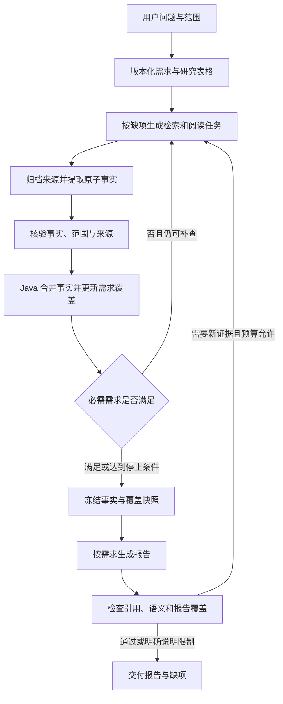

# Research 完成度改造行动计划

日期：2026-10-20  
状态：主体代码改造已接入，集中回归与隔离数据库联调见第 19 节；仍有既有契约失败，真实评测与发布验收尚未完成。  
范围：基于当前 NoteWeave、2026-10-20 评测、Table-as-Search 原论文及官方实现，提升问题回答完整性，同时保持事实准确性和引用可追溯性。

## 1. 决策与目标

采用增量改造：保留 Java 对状态、预算、租约、提交和终态的控制，扩展现有候选事实簇，把研究过程统一为：

**明确需求 → 查找证据 → 逐项核验事实 → 计算需求覆盖 → 针对缺口补查 → 按需求组织报告。**

优先解决三个问题：

1. 多个互补事实可以共同回答一个研究项，并且跨任务累计保留。
2. 事实是否可信、需求是否覆盖完整分别判断。
3. 调度器根据具体缺项决定下一步，完成判定和报告生成使用同一份需求覆盖记录。

本轮目标不包括更换整个 Agent 框架、迁移到 MongoDB、无限增加搜索次数或降低证据校验要求。模型配置优化放在结构改造之后，单独做对照实验。

### 需求摘要

- 支持比较、综述、事实查询、争议分析四类研究任务。
- 用户明确列出的对象、子问题、数量、版本、时间和来源限制必须被规划和验收覆盖。
- 不完整的研究允许结束，但应给出可靠的已完成部分、缺项及原因。
- 不得通过删减需求、增加简单单元格、放宽核验来提高完成率。
- 沿用现有归档、幂等、CAS、租约隔离、预算结算和版本审计能力。
- 生产提示词不得读取评测集的 `must_cover` 或参考答案。

## 2. 当前情况与问题依据

### 2.1 可以确认的评测结果

| 记录 | 结果 | 可以得出的结论 |
|---|---|---|
| 完整基线 20 题 | 6/20 质量通过；有效单元格完成率 92.24% | 单元格指标不能直接代表任务回答完整性 |
| 基线比较题 | 2/8 通过 | 表格即使填满，仍可能遗漏关键比较维度 |
| 基线综述题 | 0/4 通过 | 多对象、多事实和覆盖广度是优先处理对象 |
| 基线事实题 | 3/4 通过 | 简单事实查询已有可用基础，需要防止改造造成退化 |
| 最新 PostgreSQL/MySQL 定向测试 | 3/10 单元格核验通过，30 次检索，质量评分未通过 | 当前补查和覆盖校验仍没有形成有效的完整回答 |

以上分别来自 [基线报告](D:/java-projects/NoteWeave/experiments/deep-research/quality-eval/reports/quality-20261020-122358-full20-fixed.md:5)、[精确统计](D:/java-projects/NoteWeave/experiments/deep-research/quality-eval/reports/quality-20261020-122358-full20-fixed.json:17) 和 [最新定向报告](D:/java-projects/NoteWeave/experiments/deep-research/quality-eval/reports/quality-20261020-162510-table-search-row-scope-smoke.md:5)。

基线使用 `deepseek-v4.1-flash`，与研究模型相同，每题三次评分。因此 30% 是现有评分口径下的基线，不能当作独立评审结论。后续部分运行曾中止，各次代码版本也不同，不能拼成一轮全量成绩；本计划不宣称最近修改已提升整体通过率。

### 2.2 已确认的结构问题

| 优先级 | 当前机制 | 影响 | 依据 |
|---|---|---|---|
| P0 | 一个单元格选择证据最多、置信度最高的一个等价事实簇作为 `candidate_value` | 多项功能、变更列表、条件组合缺少共同参与完成判定的正式表示 | [候选生成](D:/java-projects/NoteWeave/workers/research-worker/app/deep_cell_executor.py:1388) |
| P0 | 当前 `answer_check` 要求本次卡片覆盖全部列要求，否则返回空的正式结果并保留部分线索 | 一项尚缺证据时，其他已查实事实也难以形成独立可累计的完成进度 | [覆盖检查](D:/java-projects/NoteWeave/workers/research-worker/app/deep_cell_executor.py:589) |
| P0 | 列要求以共享文本列表进入各行任务，范围主要依赖提示词解释 | 比较题可能要求某个对象回答另一个对象的专属问题 | [模型定义](D:/java-projects/NoteWeave/workers/research-worker/app/models.py:45)、[任务指导](D:/java-projects/NoteWeave/backend/src/main/java/com/noteweave/research/ResearchAgentTaskCoordinatorService.java:512) |
| P0 | 完成门禁主要根据单元格状态、证据和必需列计算；部分完成阈值使用必需单元格比例 | 多部分问题的内容覆盖与终态之间存在距离 | [完成门禁](D:/java-projects/NoteWeave/backend/src/main/java/com/noteweave/research/ResearchAgentRunCompletionGate.java:268) |
| P1 | 补查已有原因、尝试过的查询和 claims，但补查目标仍主要按 cell 表示 | 不易明确区分缺少新事实、缺少佐证、存在矛盾、来源版本错误 | [补查快照](D:/java-projects/NoteWeave/backend/src/main/java/com/noteweave/research/ResearchAgentTaskCoordinatorService.java:875)、[补查策略](D:/java-projects/NoteWeave/backend/src/main/java/com/noteweave/research/ResearchAgentRepairStopPolicy.java:16) |
| P1 | 来源优先级目前对传入的同列卡片选择最高档集合 | 较低档但回答另一个子问题的材料可能被移到线索，需要按事实和需求细分选择 | [来源选择](D:/java-projects/NoteWeave/workers/research-worker/app/deep_cell_executor.py:670) |
| P1 | 成文以已核验单元格为主，补充同格候选簇证据，每格最多 8 条；未核验线索另有上限 | 保存过材料不等于材料已进入需求覆盖和最终答案；固定截断可能遗漏独有事实 | [成文输入](D:/java-projects/NoteWeave/backend/src/main/java/com/noteweave/research/ResearchAgentRoleWorkflowService.java:204)、[补充证据](D:/java-projects/NoteWeave/backend/src/main/java/com/noteweave/research/ResearchAgentRoleWorkflowService.java:304) |
| P1 | 现有成文守卫检查引用、数字、版本、主体和单元格出现情况 | 仍需要进一步验证每条自然语言结论是否得到对应事实支持，以及必需需求是否写入报告 | [Worker 守卫](D:/java-projects/NoteWeave/workers/research-worker/app/narrative_report.py:377)、[Java 守卫](D:/java-projects/NoteWeave/backend/src/main/java/com/noteweave/research/ResearchAgentSynthesisValidationService.java:222) |

需要避免过度归因：未选中的事实簇已经保存在 `research_claim_cluster`，成文阶段也会读取其中部分证据。因此目前的问题不能概括为其他事实全部丢失。准确的问题是：多事实尚未成为贯穿核验、覆盖、补查和成文的统一状态。[事实簇持久化](D:/java-projects/NoteWeave/backend/src/main/java/com/noteweave/research/ResearchClaimClusterService.java:23)、[既有表结构](D:/java-projects/NoteWeave/backend/src/main/resources/db/migration/V141__research_semantic_claim_clusters.sql:1)

项目也已有 `ResearchIntentCompletionContract`、`required_finding_progress` 和意图校验。先复用其语义与可用映射，再接入当前 Java 主导的执行链，避免再建立一套互不相通的覆盖模型。[意图模型](D:/java-projects/NoteWeave/workers/research-worker/app/models.py:796)、[进度绑定](D:/java-projects/NoteWeave/workers/research-worker/app/state.py:345)、[意图校验](D:/java-projects/NoteWeave/workers/research-worker/app/verifier.py:844)

## 3. 如何借鉴原论文和原项目

参考对象是 [Table-as-Search 原论文](https://arxiv.org/html/2602.06724v1) 和 [官方实现的固定版本](https://github.com/AIDC-AI/Marco-Search-Agent/tree/2be90e40519f67916b4d7a621491e04efac0b6de/Marco-DeepResearch-Family/Table-as-Search)。

论文第 3.2 节将候选对象、约束和待查属性保存在表中；Planner 根据当前状态选择 `ExpandRows` 或 `PopulateCells`，在表格饱和或预算结束后生成回答。`null` 表示待查，`N/A` 表示无需查询。第 7 节还讨论了规划能力对结果的影响。

| 原论文做法 | NoteWeave 的落地方式 |
|---|---|
| 表格作为持续更新的研究状态 | 表格展示由事实和覆盖记录派生；不能仅依据一个单元格字符串决定完成 |
| 根据缺口选择扩展对象或补全属性 | 复用现有 discovery 和 repair 调度，新增需求级缺口类型与收益记录 |
| 多轮检索更新同一张表 | 新事实增量合并，已核验事实跨任务保留，重复查询不重复计分 |
| 区分待查与不适用 | 明确 `PENDING`、`UNSUPPORTED`、`NOT_APPLICABLE`，找不到材料不等于不适用 |
| 读取结构化结果再回答 | 按需求读取经过核验的事实和证据，并校验报告的覆盖情况 |

现有 discovery 已有扩展对象、饱和检测和轮数限制，应该在此基础上增加需求覆盖反馈。[现有循环](D:/java-projects/NoteWeave/backend/src/main/java/com/noteweave/research/ResearchDiscoveryLoopService.java:25)

原项目的数据库工具和模型主导调度用于理解机制。NoteWeave 继续使用自己的归档与事务边界。论文成绩来自其他模型、预算和数据集，不能直接作为本项目预期通过率。

## 4. 目标设计

### 4.1 一份需求记录贯穿全过程

以下为目标设计，实际代码落实与保留边界见第 10 至 18 节及实施记录。

### 4.2 四类核心记录

| 记录 | 关键字段 | 作用 |
|---|---|---|
| `Requirement` | `requirement_id`、`parent_id`、`plan_revision`、`origin`、`scope`、`predicate`、`mandatory`、`target_count` | 描述需要回答什么，范围包括对象、版本、时间和条件 |
| `Fact` | `fact_id`、`cell_key`、`claim_text`、`scope`、`evidence_keys`、`verification_status`、`revision` | 保存一个可独立核验的结论及其证据 |
| `RequirementCoverage` | `requirement_id`、`fact_ids`、`status`、`missing_parts`、`reason_code`、`checked_revision` | 记录哪些事实共同满足哪个需求，缺少什么 |
| `CellProjection` | `cell_key`、`fact_ids`、`coverage_summary`、`display_value` | 给表格和兼容接口提供展示值，不承担全部事实状态 |

建议以现有 `research_claim_cluster` 保存等价事实与来源关系，扩展事实资格、范围和修订信息；新增需求及需求与事实的关系存储。只有当任务级事实簇无法满足跨任务身份和修订要求时，再引入独立 `research_fact` 表，通过关系表关联既有簇，避免复制原文和来源归档。具体迁移版本号在实施时按仓库顺序分配。

`origin` 区分：

- `EXPLICIT`：用户明确提出，完整保留。
- `DERIVED`：回答问题必需的推导研究项，记录理由与规划版本。
- `EXPLORATORY`：补充背景，不阻止主要任务完成。

明确需求、派生需求分别统计覆盖率。规划修订可增加或重组研究项，但不能静默删除用户要求或将缺项改为可选来提高指标。

### 4.3 核验与覆盖分别建模

- 事实核验：`UNVERIFIED / VERIFIED / REJECTED / DISPUTED`。
- 需求覆盖：`PENDING / PARTIAL / SATISFIED / BLOCKED`。
- 是否适用独立表示；`NOT_APPLICABLE` 必须有范围依据及审计记录。
- 来源是否新鲜、版本是否匹配、是否通过反证检查是事实资格条件。
- 一个事实可以服务多个需求；同一事实不能在要求多个不同发现时重复计数。
- 多个不同事实不会因为放在同一格而互相增加置信度。佐证独立性仍按同一事实的来源计算。
- 互补事实并存；同一范围内的互斥事实进入冲突处理；不同版本的相反结论先按范围分离。
- 被撤回或范围失效的事实会使依赖它的覆盖结果失效，重新计算；不能只增不减。
- 未抓到页面、没有搜到、模型没有判断结果均不能解释为不存在或不适用。

### 4.4 PostgreSQL/MySQL 的具体例子

用户要求比较两种数据库的 JSON 能力时：

1. 创建 PostgreSQL 行和 MySQL 行。
2. 为各行分别创建存储、索引形式、可加速操作、使用条件、写入或更新代价等适用需求；具体维度仍由问题与来源决定。
3. MySQL 专属函数需求只绑定 MySQL，跨产品比较需求则依赖两行已有事实。
4. 第一轮查到两个事实，即使第三项缺失，也保留两个已核验事实。
5. 第二轮仅查缺少的操作、函数或限制，合并后重新计算覆盖。
6. 最终比较按各行事实生成，引用跟随对应事实，不能把 MySQL 的结论放进 PostgreSQL 句子。

该示例只用于协议和回归场景设计，不能把评测答案写进生产提示词。

## 5. 分阶段行动计划

### 阶段 0：固定评测口径与可重放样本

优先级 P0；预计 1 人日；其他阶段的验证基础。

行动：

1. 保存基线代码、配置非敏感摘要、模型标识、数据集、时间范围、运行镜像及报告的对应关系。
2. 将已归档失败材料整理为可重放样本，分别定位提取、资格校验、候选生成、覆盖、补查、成文各阶段。
3. 每个样本标注明确的缺项或错误行为，标注不进入生产模型上下文。
4. 将关键实验包装能力从 `.codex-tmp` 收敛进正式评测脚本；运行期间检测代码/镜像变化，变化时标记该轮不可比较。
5. 增加各阶段计数：提取事实数、核验事实数、去重事实数、满足需求数、报告覆盖需求数，以及每次过滤原因。
6. 在调优前冻结留出集的题目、评分要求和摘要校验值，隔离于开发回放和生产输入；正式评测前不使用其结果修改提示词。

修改入口：[运行脚本](D:/java-projects/NoteWeave/scripts/deepresearch/run_quality_eval.py)、[评分脚本](D:/java-projects/NoteWeave/scripts/deepresearch/score_quality_eval.py)、[评测说明](D:/java-projects/NoteWeave/experiments/deep-research/quality-eval/README.md)。

验收：

- 建立至少 12 个机制回放场景，覆盖本计划第 6 节的关键风险。
- 每次运行可定位对应代码、配置、模型、输入和来源快照。
- 网络错误、评分未完成、证据不足分别统计；未获得三次有效评分不能提前判定该题结果。
- 实际端到端通过率以全部指定题数为分母，同时另报网络可用性，不能删除失败题提高成绩。

### 阶段 1：把需求变成稳定、按范围绑定的契约

优先级 P0；预计 2–3 人日；依赖阶段 0。

行动：

1. 将共享 `requirements: list[str]` 编译为有稳定 ID、对象范围和验收方式的需求。
2. 支持单个事实、多个事实共同满足、至少 N 个不同发现、对象覆盖、跨行比较几种完成条件。
3. 明确用户指定版本和研究截止时间；`as_of` 在 Run 创建时冻结，后续任务沿用。
4. 复用现有意图契约和进度字段，建立与 Java 主执行链的映射；明确旧路径适配边界。
5. 为快照、回执、canonical digest、receipt 和重放同步定义新能力。当前 completion 为 v2，可拟新增 completion v3；task snapshot 已支持 v3，不能误以为同名版本尚未使用。
6. Worker 只能提交事实和覆盖建议；Java 校验引用、范围、修订与资格后生成权威覆盖记录。

主要入口：[规划 Worker](D:/java-projects/NoteWeave/workers/research-worker/app/planning_executor.py:301)、[模型](D:/java-projects/NoteWeave/workers/research-worker/app/models.py)、[Java 规划](D:/java-projects/NoteWeave/backend/src/main/java/com/noteweave/research/ResearchPlanningService.java:279)、[任务快照](D:/java-projects/NoteWeave/backend/src/main/java/com/noteweave/research/ResearchAgentTaskCoordinatorService.java:512)、[回执契约](D:/java-projects/NoteWeave/backend/src/main/java/com/noteweave/research/ResearchAgentCompletionEnvelope.java:96)、[规范化](D:/java-projects/NoteWeave/backend/src/main/java/com/noteweave/research/ResearchAgentCompletionCanonicalizer.java:154)。

验收：

- 固定样本中每条用户明确要求均映射到至少一个需求 ID。
- 行专属要求不会派发给其他对象；跨行要求可以关联多行，不能复制成每行都需要回答全部对象。
- 同一 Run 的研究截止时间一致，需求修订有原因且保留旧版本。
- v2 回放仍可运行；不支持新协议的 Worker 不领取新协议任务，不能静默忽略事实字段。

### 阶段 2：多事实保存、逐事实核验和跨轮累计

优先级 P0；预计 3–4 人日；依赖阶段 1。

行动：

1. 让 `_candidate_payload` 的单一代表值退为兼容展示；正式提交保留各个互补事实及各自证据。
2. `equivalent_claims` 继续仅表示等价说法，不能把多个独立结论拼进去绕过现有校验。
3. 将 `_keep_answering_cards` 拆成事实相关性/支持判断和需求覆盖判断；缺一个研究点不能导致其他已核验事实失去资格。
4. 按语义及对象、版本、条件确定事实身份；跨任务去重，同时保存新的独立佐证。
5. Java 在同一事务中记录事实、关系、覆盖修订和预算结算。事实合并沿用租约隔离与 CAS。
6. 过期任务不能覆盖新状态；其中可能有价值的材料保留为待重新校验材料，不能直接升级为已核验事实。
7. 处理事实撤回、冲突、来源失效及规划变更，正确失效依赖覆盖。
8. 审计所有固定截断：当前每格最多 6 个簇等限制应按需求覆盖选择并记录截断原因；超预算时明确列缺项，不能静默丢弃独有事实。
9. 梳理原有 `VERIFIED`、冻结和双候选核验的粒度。已核验事实可以保持稳定，但仍有必需缺项的单元格应允许提交新事实；核验同一事实的来源不能被其他互补事实替代。原有按单个代表值比较的路径需要显式适配。

主要入口：[候选生成与覆盖检查](D:/java-projects/NoteWeave/workers/research-worker/app/deep_cell_executor.py:589)、[事实簇](D:/java-projects/NoteWeave/workers/research-worker/app/claim_clustering.py:55)、[簇存储](D:/java-projects/NoteWeave/backend/src/main/java/com/noteweave/research/ResearchClaimClusterService.java:23)、[证据资格](D:/java-projects/NoteWeave/backend/src/main/java/com/noteweave/research/ResearchEvidenceQualificationService.java:158)、[合并策略](D:/java-projects/NoteWeave/backend/src/main/java/com/noteweave/research/ResearchAgentCompletionMergePlanner.java:25)、[事务提交](D:/java-projects/NoteWeave/backend/src/main/java/com/noteweave/research/ResearchAgentCompletionCommitter.java)。

验收：

- 同一格三个互补事实全部保留，各自可追溯，不能只剩一个正式事实。
- 第一轮满足 2/3、第二轮找到最后 1/3 后，累计覆盖达到 3/3。
- 重复回执不增加事实数量或预算支出；过期修订不能覆盖新结果。
- 复述、镜像、转载不满足不同发现数量要求，也不虚增独立来源数量。
- 一条事实撤回后，依赖它的需求转回缺项；互补事实不被当作冲突。

### 阶段 3：按缺项补查，按需求结束

优先级 P0；预计 2–3 人日；依赖阶段 2。

行动：

1. 补查快照增加 `missing_requirement_ids`、已有合格事实、缺项类型、历史查询、已读文档、来源与版本限制。
2. 统一动作：
   - `EXPAND_ROWS`：缺少需要研究的对象。
   - `POPULATE_REQUIREMENTS`：缺少事实或某个要求的一部分。
   - `READ_TARGETED`：已定位文档，需要阅读特定章节。
   - `CORROBORATE`：事实已有，但缺少合格或独立来源。
   - `RESOLVE_CONFLICT`：存在同范围互斥结论。
   - `SYNTHESIZE`：研究需求达到条件，或只能诚实交付部分结果。
3. 为明确需求保留首轮查询机会，按必需程度、预期新增覆盖、来源可达性和预计成本排序；先使用可解释规则，暂不增加复杂学习调度器。
4. 用新增合格事实、已满足需求、已解决冲突衡量收益。只有新 URL、改写了查询或增加背景文本不算完成度增益。
5. 重复文档优先重读相关窗口；查询和抓取去重。连续两轮无上述收益可作为初始停止配置，但仍须检查剩余未尝试动作。
6. 完成门禁改为需求覆盖驱动，并保留证据、反证和语义审计约束。成功必须满足所有适用的必需要求。
7. 有缺项但预算、时间或合理动作耗尽时，返回部分结果和明确原因；可靠事实可交付，完整完成标记不可授予。
8. 报告检查发现缺失事实时，只能由协调器创建有预算的新一轮补查，不能让成文 Worker 自行搜索。

主要入口：[调度服务](D:/java-projects/NoteWeave/backend/src/main/java/com/noteweave/research/ResearchAgentTaskCoordinatorService.java:875)、[停止策略](D:/java-projects/NoteWeave/backend/src/main/java/com/noteweave/research/ResearchAgentRepairStopPolicy.java:16)、[完成门禁](D:/java-projects/NoteWeave/backend/src/main/java/com/noteweave/research/ResearchAgentRunCompletionGate.java:268)、[扩展循环](D:/java-projects/NoteWeave/backend/src/main/java/com/noteweave/research/ResearchDiscoveryLoopService.java:25)、[补查查询](D:/java-projects/NoteWeave/workers/research-worker/app/repair_queries.py:12)。

验收：

- 指定回放中，第二轮任务只包含尚未满足的需求或需要追加核验的事实。
- 已完成需求不反复搜索，除非明确记录失效或冲突原因。
- 单元格均为 `VERIFIED` 但必需需求缺失时，不得给出完整完成状态。
- 空结果、不可访问、预算耗尽、需求不适用的原因不混用。
- 在不同任务完成顺序、重复投递、取消和预算边界下，均能稳定结束。

### 阶段 4：改进规划完整性与任务类型适配

优先级 P1；预计 2–3 人日；需求契约稳定后实施。

行动：

1. 规划先覆盖用户显式要求，再使用有限的权威资料探查确认领域结构，随后进行一次完整性复核。
2. 研究项描述需要查证的问题，不能预填模型记忆中的答案。
3. 比较题使用共享维度、行内适用条件和跨行比较关系。
4. 综述题拆开对象数量、核心机制、流程阶段、限制等维度；显式数量使用不同事实/对象去重计数。
5. 事实题区分首次引入、指定版本行为、当前支持状态，避免使用历史文档回答当前状态。
6. 争议题要求记录支持证据、反对证据、研究条件和适用边界；无可靠证据的一方明确缺失，不能为对称结构制造结论。
7. 对开放式问题给出可操作的研究范围和停止标准，不承诺穷尽整个领域。
8. 维度过多时优先级分层。不能因列数上限合并后丢失原始需求。

主要入口：[规划提示与校验](D:/java-projects/NoteWeave/workers/research-worker/app/planning_executor.py:152)、[列合并](D:/java-projects/NoteWeave/workers/research-worker/app/planning_executor.py:401)、[查询规划](D:/java-projects/NoteWeave/workers/research-worker/app/cell_query_planner.py:87)、[Java 规划存储](D:/java-projects/NoteWeave/backend/src/main/java/com/noteweave/research/ResearchPlanningService.java)。

验收：

- 固定结构回归中，显式对象、版本、数量和子问题覆盖率 100%。
- 列合并和重新规划后，需求 ID 的可追溯关系完整。
- 四种题型都能生成与问题一致的完成条件。
- 不访问评测答案；额外使用未参与开发的问题验证规划泛化。

### 阶段 5：来源、版本、时间与定向阅读统一约束

优先级 P1；预计 2–3 人日；可在阶段 2 完成后推进。

行动：

1. 为来源记录对象、文档分支、软件版本、发布日期、更新时间、抓取时间、原始地址、规范化地址和来源关系；未知字段明确为未知。
2. 软件能力优先原版本官方文档；效果与争议问题优先原始研究及可核查方法，不能一律用厂商文档替代实证证据。
3. 来源适用性按事实与需求判断，避免按整格最高档材料一并排除其他研究点的相关材料。
4. 对搜索结果、阅读、补查、归档复用、待核验线索和成文统一应用对象/版本/来源规则。
5. 已命中官方目录或概览时，沿相关章节、锚点、版本目录继续阅读；限定访问预算、去重和允许的链接范围。
6. 证据窗口覆盖支撑完整命题的必要上下文，包括限定条件；不能随意截断后仍声称支持整个结论。
7. 历史版本材料可保留为历史事实；不能自动证明最新状态。不同 URL 的同源转载继续去重。

主要入口：[来源选择](D:/java-projects/NoteWeave/workers/research-worker/app/deep_cell_executor.py:670)、[抽取](D:/java-projects/NoteWeave/workers/research-worker/app/extractor.py)、[检索适配](D:/java-projects/NoteWeave/workers/research-worker/app/search_adapters.py)、[证据资格](D:/java-projects/NoteWeave/backend/src/main/java/com/noteweave/research/ResearchEvidenceQualificationService.java)、[成文证据读取](D:/java-projects/NoteWeave/backend/src/main/java/com/noteweave/research/ResearchAgentRoleWorkflowService.java:304)。

验收：

- 固定回归中，旧版、开发版、其他产品、镜像均不会被错误提升为指定版本的正式证据。
- 来源约束在主路径与补查、线索、成文路径一致。
- 目录页不足时可定位具体章节，并补足对应需求。
- 版本未知或范围无法判断时保留不确定状态，不依靠模型猜测通过。

### 阶段 6：按需求组织报告，逐结论检查支撑

优先级 P1；预计 2–3 人日；依赖阶段 2、3、5。

行动：

1. 成文输入从代表值与散列证据升级为需求、合格事实、原文、范围及缺项。
2. 冻结快照的 digest 覆盖需求修订、事实修订、覆盖记录和证据身份；修订后旧成文结果失效。
3. 优先选取能覆盖不同必需需求的事实，再分配背景和佐证。超过上下文预算时分节生成，不能直接截掉独有事实。
4. 报告结构依次回答用户需求，最后补充限制与待查项；附加所有单元格文本不能替代完整回答。
5. 建立 `statement_id → fact_ids → evidence_keys` 映射；一句包含多个事实时逐一映射或拆句。
6. 保留 Java 与 Worker 的数字、版本、引用和主体守卫；增加有证据输入的语义支持检查，不能只检查词面重合。
7. 对失败段落限次局部重写；如事实本身缺失，交给协调器补查。有限重试后交付已通过部分并列缺项。
8. 表格、摘要、正文使用同一事实快照和覆盖口径。未经核验线索不能进入确定性摘要。

主要入口：[成文任务](D:/java-projects/NoteWeave/backend/src/main/java/com/noteweave/research/ResearchAgentRoleWorkflowService.java:204)、[报告生成](D:/java-projects/NoteWeave/workers/research-worker/app/narrative_report.py:252)、[Java 校验](D:/java-projects/NoteWeave/backend/src/main/java/com/noteweave/research/ResearchAgentSynthesisValidationService.java:121)、[前端报告](D:/java-projects/NoteWeave/frontend/src/features/research/ResearchReportView.tsx)。

验收：

- 每个 `SATISFIED` 的必需需求均在报告中有对应答案和引用；没有答案则降低报告覆盖状态。
- 错主体、错版本、单条证据支撑整个多项列表等固定反例全部拒绝。
- 摘要与正文不矛盾；删除无效引用时不能保留失去支撑的结论。
- 分节生成与局部修订后仍可追溯每条事实，最终报告不会掩盖缺项。

### 阶段 7：可观测性、成本控制与发布验证

优先级 P2，其中必要指标从阶段 0 开始；预计 2–3 人日，不含外部服务等待。

行动：

1. 显示用户需求覆盖、派生需求覆盖、报告覆盖、可靠事实数、未解决冲突和停止原因。
2. 每轮记录查询数、读页数、模型调用、token、耗时、新增合格事实、新满足需求及重复文档率。
3. 用每个新增满足需求的成本补充 `queries_per_effective_cell`，避免简单单元格拉低平均成本。
4. 初期沿用当前研究模型，以隔离架构改动收益。随后只对规划复核、歧义覆盖判断、冲突判断试验更强模型，其他环节保持不变。
5. 为规划、搜索、抽取、核验、补查和成文设置预算保留，记录真实消耗；不把所有预算提前花在第一轮搜索。
6. 独立配置评分模型，用相同评分器同时重评基线和候选结果；同一模型三次评分只用于降低随机波动，不能替代评审独立性。
7. 前端从后端权威记录展示需求进度，不自行计算另一套完成率。

主要入口：[预算与检查点](D:/java-projects/NoteWeave/backend/src/main/java/com/noteweave/research/ResearchBudgetAndCheckpointService.java)、[模型客户端](D:/java-projects/NoteWeave/workers/research-worker/app/llm_client.py)、[评分器](D:/java-projects/NoteWeave/scripts/deepresearch/score_quality_eval.py:201)、[单元格界面](D:/java-projects/NoteWeave/frontend/src/features/research/ResearchCellsPanel.tsx)、[补查界面](D:/java-projects/NoteWeave/frontend/src/features/research/ResearchRepairPanel.tsx)。

验收与目标见下一节。未通过结构与正确性验证，不进入模型升级和成本微调实验。

## 6. 测试与质量验收

### 6.1 必须通过的机制回归

| 场景 | 必须满足的行为 |
|---|---|
| 同格三个互补事实 | 三个事实都有独立证据，可共同满足需求 |
| 两轮各找到一部分 | 后一轮累计前一轮合格事实，不重新从空状态判断 |
| 一项缺失 | 已核验事实保留，需求标记 PARTIAL |
| 多来源复述同一事实 | 不重复计入不同事实数量 |
| 同源转载 | 不虚增独立来源数量 |
| 两个产品的专属要求 | 范围不串行、不混淆主体 |
| 跨产品比较 | 依赖各行事实，缺一方时不虚构比较结论 |
| 指定版本与历史材料混合 | 历史材料不能冒充指定或当前版本 |
| 真冲突与条件不同 | 同范围冲突保留，条件不同的结论可并存 |
| 过期任务与重复回执 | 不覆盖新状态，不重复结算 |
| 事实撤回与规划修订 | 依赖覆盖和旧报告快照失效 |
| 数量与不适用 | 去重后计数；没有结果不能算不适用 |
| 成文遗漏与错误引用 | 必需答案不得无故遗漏，引用对应具体命题 |
| 预算耗尽和模型超时 | 有限时间内退出，交付部分事实及准确原因 |

验证分层：

1. 纯规则测试：需求编译、范围、去重、覆盖聚合、终态和失效传播。
2. 跨语言契约测试：同一组载荷分别验证 Python、Java 的接受和拒绝结果；比较 canonical digest 与类型规则。
3. 数据库集成测试：事务原子性、CAS、幂等、租约过期、预算和审计。
4. 固定来源回放：验证多事实是否在处理链中保留，减少实时搜索波动。
5. 模型语义回放：固定来源、固定模型配置，重复运行关键场景，检查语义判断稳定性。
6. 真实端到端评测：检索、阅读、归档、核验、成文、独立评分一起验证。

测试应验证行为和失败边界，不以重复实现细节或增加测试数量作为目标。

### 6.2 分阶段质量目标

下面是拟议验收目标，不是已经取得的结果，也不是通过率保证。

| 指标 | 目标 |
|---|---|
| 机制回归 | 所有必测场景通过，无新增错误核验或事务一致性问题 |
| 显式需求映射 | 固定结构回归覆盖率 100% |
| 必需报告覆盖 | 已满足的必需需求 100% 出现在最终答案并附证据 |
| 开发集第一阶段 | 固定 20 题质量通过至少 12/20；沿用旧评分口径仅作兼容比较 |
| 分题型 | 比较至少 4/8，综述至少 2/4，事实至少 3/4，争议至少 2/4；同时满足总数至少 12/20 |
| 重复运行 | 候选版本至少两轮完整 20 题，每轮每题三次有效评分；分别报告，不挑最好一轮 |
| 独立评分对照 | 基线与候选由同一独立评分器重评，报告逐题改善、退化与无变化 |
| 成本与耗时 | 第一阶段相对可比较基线，总 token 和 P95 耗时原则上不超过 1.5 倍；超出必须说明收益与配置原因 |
| 留出集 | 预先冻结至少 20 道未用于调试的新题，按四类分层；候选相对可重跑基线至少多通过 4 题，严重错主体/错版本/无证据结论不得增加 |

12/20 是开发里程碑；独立评分与留出集用于检查泛化。20 题规模不足以证明普遍或统计显著提升，需要报告原始配对结果和样本局限，不给出过度结论。

若无法恢复基线代码环境，必须明确限制：旧报告可做输出重评，不能假装完成了实时环境下的公平双版本对照。对应发布结论降级，直到补齐可重跑对照。

### 6.3 评测顺序

1. 通过机制与契约回归。
2. 固定来源重放 PostgreSQL/MySQL、Rust 多变更、向量检索流程、Python 当前状态，以及至少一个争议题。
3. 使用同一候选镜像跑真实定向样本，每题三次有效评分。
4. 候选版本冻结后完整跑 20 题，不边跑边改代码。
5. 第二轮完整复跑，报告波动；同一模型的三次评分不算研究任务的三次重跑。
6. 独立评分器重评基线和候选，人工抽查所有改善、退化及评分分歧明显的题目。
7. 对阶段 0 已冻结的留出集执行双版本对照；根据结果决定发布或继续修复。若用这批结果继续调优，则该批转为开发集，下次正式验收需要新的留出集。

## 7. 兼容、发布和回退

1. 先新增字段与表，不删除旧数据。旧结果按一个或多个历史候选导入兼容视图，覆盖未知的部分标记未评估，不能直接标为满足。
2. 新协议在任务创建时协商；禁止新旧 Worker 在不知情的情况下处理同一份新格式任务。
3. 分三个开关推进，名称在实现时确定：需求记录、事实累计、需求驱动调度。最终使用者界面随权威接口稳定后开放。
4. 第一阶段影子计算：新增覆盖记录但不改变终态，比较旧逻辑与新逻辑的差异。
5. 第二阶段仅对新 Run 开启新路径；运行中的旧 Run 沿用其创建时的配置和协议。
6. 回退作用于后续新 Run；已有新协议 Run 应由兼容版本完成，或明确暂停/取消并从检查点重新启动。不能让旧程序接管无法识别的状态。
7. 修订事实或计划后重新生成依赖的覆盖与报告快照，旧快照保留审计记录。
8. 只有结构回归、完整评测、独立评分和成本门槛都满足后，才考虑默认开启。

## 8. 排期与交付件

按一名熟悉代码库的工程师估算，共 16–23 人日；考虑契约迁移、评测和返工，日历时间预留约 4–6 周。该估算需要在阶段 1 完成数据模型评审后更新。

| 顺序 | 工作包 | 预计投入 | 主要交付件 |
|---|---|---|---|
| 1 | 阶段 0 | 1 人日 | 固定基线、失败回放、指标定义 |
| 2 | 阶段 1 | 2–3 人日 | 需求契约、范围绑定、协议兼容设计 |
| 3 | 阶段 2 | 3–4 人日 | 多事实增量提交、覆盖记录、回放证据 |
| 4 | 阶段 3 | 2–3 人日 | 按缺项调度、覆盖驱动完成门禁 |
| 5 | 阶段 4 | 2–3 人日 | 四类任务规划规则与回归 |
| 6 | 阶段 5 | 2–3 人日 | 全链路来源范围约束、定向阅读 |
| 7 | 阶段 6 | 2–3 人日 | 需求驱动报告、结论到证据映射 |
| 8 | 阶段 7 | 2–3 人日 | 可观测指标、独立评分、发布对照 |

第一周的具体交付目标：

1. 把多事实、跨轮累计、跨对象范围、当前版本四类失败固化为可重放样本。
2. 完成需求/事实协议设计及兼容测试，明确复用现有意图和事实簇模型的方式。
3. 跑通一个端到端的最小实现：两轮提交事实 → Java 累计 → 覆盖从部分变完整 → 报告使用全部相关事实。
4. 第一周若尚未跑通这个流程，暂停扩展规划提示词和真实全量评测，优先修复契约及状态问题。

建议将阶段 0–2 作为第一批实施范围。其验收结果决定后续投入，避免同时修改规划、检索、核验和成文后无法定位收益来源。

## 9. 主要风险与控制措施

| 风险 | 控制措施 |
|---|---|
| 新需求拆分过细，导致表面完成率下降、成本增加 | 区分显式、必要派生、探索性需求；冻结口径并按重要性分配预算 |
| 模型把弱支持当作需求满足 | 每个覆盖结论必须指向合格事实与证据；规则校验加模型语义检查；保留抽查 |
| 多事实累计混入旧版本或别的对象 | 事实范围参与身份、合并、覆盖及报告校验，全链路使用同一范围 |
| 互补事实误当成等价或矛盾 | 明确等价、互补、同范围矛盾三类关系，使用各自回归场景 |
| 跨语言协议更新不一致 | 共享载荷样本、digest 对照、版本协商与受控发布 |
| 报告上下文变大 | 按需求选事实，必要时分节；记录截断与缺项，禁止静默丢失独有事实 |
| 为已有 20 题过拟合 | 仅用失败题验证机制，生产不读答案；冻结新题留出集做对照 |
| 新检查增多造成延迟 | 规则先行、内容摘要缓存、按风险做语义复核；对照真实 token 与 P95 |
| 评分模型偏差 | 同口径重评、独立模型、逐题配对结果、人工抽查三者结合 |

完成本计划的判断依据是：在明确需求和证据约束下，系统能够保留有效发现、补足具体缺项，并稳定产出更完整的回答；单元格数量、测试数量或单次成功案例都不能单独证明目标达成。

## 10. 首批实施记录

本批优先实现阶段 0–2 的主链路，并接入必要的补查、成文和展示入口，尚未完成整个计划。

已接入的功能：

- `V169` 新增需求、事实、事实佐证、联合覆盖观察和每轮增益记录，沿用既有完成事务。
- 任务创建时绑定对象、单元格、规划修订、实体集修订及固定研究日期，生成稳定需求 ID 和契约摘要。
- Worker 逐项提交覆盖建议，保留能够回答部分要求的事实，并在后续任务中使用历史合格事实。
- Java 对每个事实继续使用既有证据资格规则；覆盖不足时拒绝完成整格，事实仍单独入库。
- 需求覆盖由多事实共同支撑；事实发生争议后，依赖覆盖会失效，无争议的互补事实继续保留。
- 新任务要求 Worker 声明 `requirement_coverage_v1` 能力，不支持的旧 Worker 无法领取新格式任务。
- 补查快照携带缺项、历史事实和固定日期，覆盖不足的单元格可以在现有两次补查上限内继续累计。
- 成文读取跨轮合格事实，避免只读最后一轮代表值的证据；超出当前成文容量时明确报出需要分节处理。
- 新增 `/requirements` 授权读取接口和前端需求进度、累计事实及引文展示。
- 正式评测脚本记录源码、数据集及公开模型标识的指纹，执行期间发生变化会将本轮标记为不可比较；运行镜像身份暂标记 `NOT_CAPTURED`。

启用方式与边界：

- 新增 `NOTEWEAVE_RESEARCH_REQUIREMENT_COVERAGE_V1`，默认关闭；开启后只影响新建 Run 的配置快照。
- 本批首先覆盖普通单候选任务。高风险和双路候选继续沿用原有核验，不使用单路事实代替双路核验。
- 当前需求来自规划研究项，统一标记 `DERIVED`。显式用户需求的原子拆分、独立数量谓词和跨任务语义去重继续按后续阶段推进。
- 未修改本地密钥，没有运行新的真实研究评测，没有宣称任务质量通过率提高。
- 按用户调整，先完成代码和功能衔接，完整测试后置；收尾只执行构建、语法检查及不调用 Provider 的最小功能回放。

后续优先顺序：完善显式需求和数量约束 → 接入高风险逐事实核验 → 统一来源范围 → 完善需求驱动成文和超长报告分节 → 集中验证并启用新路径。

本批收尾检查：

- Java 主代码编译通过，前端 TypeScript 构建检查通过，Worker 语法检查通过。
- Worker 离线回放：第一轮保留一个正确事实并覆盖一项，第二轮使用历史事实和新事实共同覆盖两项。
- Java 覆盖累计回放：第一轮阻止整格完成，第二轮累计两条事实后允许完成；将其中一条标为争议后，覆盖降回一项，另一条事实保留。该回放假定上游资格核验通过，不替代正式证据核验测试。
- Java 生成的需求契约由 Python 验证，跨语言摘要一致。
- 未运行完整测试集、真实端到端评测或新版本服务部署；质量通过率仍以既有报告为准。

## 11. 第二批实施记录

本批继续完善显式需求、数量约束和报告生成，功能开关仍默认关闭，运行中的服务未替换。

已接入的功能：

- 规划单独提交 `user_requirements`，保留问题原文、适用对象、研究维度、数量表达式和最小数量。Python 与 Java 分别核对原文及数量，派生研究项继续独立保存。
- `V170` 增加 `SINGLE`、`DISTINCT_FACTS`、`DISTINCT_ENTITIES`、范围和原文等字段，覆盖观察区分 `PARTIAL` 与 `SATISFIED`。协议 v2 由 Worker 能力协商保护；旧 Run 继续按原协议处理。
- 不同事实使用去重后的事实计数；等价性不能确定时保留缺项。研究对象数量由 Java 按正式核验的不同研究行和该行需求完成情况计算，不能把多条来源当成多个研究对象。
- 需求进度展示用户明确要求、补充研究项、部分覆盖、数量和原始要求。宽搜索接收缺项和数量目标，优先寻找仍缺少的研究对象。
- 用户明确要求的对象与维度不能被规划的不适用标记排除。显式需求尚未解析时，完成门禁保留缺口。
- 普通单路反证补查逐个处理事实簇；Java 拒绝将未执行反证或已经被反驳的事实计入覆盖，不沿用代表值的核验结果。
- 报告输入冻结全部合格累计事实、联合引用、需求进度和缺项，并把需求快照纳入摘要；成文期间这些状态变化时拒绝使用旧报告。
- Worker 按事实和引文大小分批成文，同格事实在预算内合并。总调用数受任务冻结预算约束，预算不足或模型不可用时使用有引用的确定性正文。
- 报告正文保留每条合格事实及其完整联合引用，Java 再次核对事实覆盖与缺项说明。超过五个研究对象时使用纵向对比表，避免只显示前五个对象。

当前边界与后续工作：

- 双路高风险任务尚未接入跨任务事实累计。其需求保留待完成状态，继续沿用原有双路来源和反证校验；完成专门适配前不能启用整个新路径。
- 跨轮事实的语义去重仍主要由 Worker 检查，Java 当前使用规范化结论与稳定身份做结构复核；后续需要保存并独立复核等价关系。
- 来源的版本、时间和产品分支仍需统一策略，当前结构检查不能代替语义与时效核验。
- 分批解决单次成文上下文过大的问题，最终提交仍受既有完成信封 256 KiB 上限约束；超大最终报告的分段持久化需要后续实现，当前不会静默截断。
- 完整测试、真实端到端评测、独立评分和受控启用仍后置；没有新的质量提升结论。

最小离线检查已确认数量不匹配会拒绝、重复事实只算一条，40 条事实在成文失败及有限调用预算下仍全部保留，六个研究对象全部进入对比表。使用离线模拟响应，未调用 Provider；这些检查不替代真实研究质量评测。

## 12. 双路高风险事实累计

继续实现了第 11 节中待接入的双路高风险路径：

- `V171` 为逐事实佐证保存任务、双路分组、执行槽、来源身份和引文指纹。这些身份来自 Java 已校验的归档来源。
- 单路暂存的双路事实不会进入历史合格事实、覆盖统计或报告。只有同组不同任务、不同执行槽的相同事实满足原有双路独立性门禁，才允许累计。
- 独立性检查复用原有合并规则，同时检查注册域名、文件血缘和引文指纹；不同组的两次执行不能拼成双路确认。
- 每条事实仍单独进行来源资格与反证检查。高风险单路补查继续要求原有的两个独立来源。
- 双路代表值通过时，整格还需通过需求覆盖门禁；需求不全时保留已经获得双路确认的事实，拒绝整格合并，单元格版本不递增。
- 锁内合并预判和持久化合并使用同一个需求门禁，保留既有事务、CAS、租约与 fencing 检查。

本路径仍等待集中回归和真实任务验证，功能开关继续关闭。双路之间语义等价但文字不同的事实暂不自动合并；只处理同一稳定事实身份，避免错误累计。第 11 节的来源范围、跨轮语义去重和超大最终报告持久化仍需后续推进。

本轮收尾检查：Java 主代码编译、TypeScript 构建检查和 Worker 语法检查通过。最小离线回放确认单路暂存、跨组组合、同域来源与重复引文均不能使双路事实进入正式累计，同组独立双路能够累计，需求不足的双路整格合并不会递增版本。该回放使用预设的合格来源及身份，验证累计门禁，不替代真实归档来源与反证链路的集中回归。

另将 Worker 生成的 40 条事实分批报告交给 Java 成文校验，正文及引用校验通过；原有两轮累计、争议撤销和跨语言契约摘要回放继续通过。未运行完整测试集、未调用真实 Provider、未部署新版本，不能据此宣称质量通过率已经提高。

## 13. 来源范围统一处理

本轮继续实现阶段 5 的确定性约束部分，入口为 `ResearchSourceScopePolicy.java` 与 Worker 的 `source_scope.py`。

新建 Run 快照记录 `requirement_state_version=3`，本轮来源范围、跨轮语义审计和报告分段协议只用于这一版本。旧 Run 的契约与显式需求 ID 保持原口径，避免在相同规划修订下生成另一批需求。

- 在任务契约中冻结每格的对象名称、明确版本、研究截止日期、时间目标、开发分支许可和来源偏好，Worker 声明 `source_scope_v1` 能力后才能领取。
- Python 与 Java 使用一致的文档目录、版本前缀和开发分支规则，明确冲突的版本、无法确认的指定版本、未经请求的开发分支不能进入正式事实。
- 版本依据来自服务器归档 URL、标题和原始窗口上下文；不以 Worker 自报的来源信息替代归档核对。JEP、PEP、RFC 编号与 Rust edition 年份不会作为软件版本比较。
- `V172` 保存事实佐证的范围判定。未知的发布日期、更新时间保持 `UNKNOWN`，抓取日期不能直接充当更新时间。
- 当前状态需求不能仅凭固定历史版本的材料判定完成；指定版本的行为与不限定版本的当前状态分别处理。冻结的需求时间目标同时用于覆盖判定和进度计算。
- 查询、补查、抽取、反证、归档复用后的事实选择、待核验线索和报告均接入范围信息。明确版本冲突或开发分支冲突的线索不会在成文时重新作为回答使用。
- 来源档次改为排序依据，保留不同研究点的合格互补资料，不再按整格最高档次删除其余事实。实证问题优先原始研究；仅出现规范编号不再被解释为所有研究点都只能使用官方文档。
- 前端展示版本范围与资料更新时间未知的状态，保留原有资料链接和引文。

这些规则处理明确的结构冲突，仍不能凭 URL 解决全部产品分支、时效和语义歧义。未知日期不等于已经确认资料当前有效，来源身份、原文含义和条件仍需结合后续审计判断。

## 14. 跨轮事实语义去重与审计分批

本轮将数量判定从 Worker 的单次去重建议推进到独立语义审计阶段。这里的独立指独立执行阶段与冻结输入，尚未配置不同模型作为审计者。

- 审计输入读取当前范围内累计的合格事实，携带引文和版本、时间范围，覆盖历史轮次，避免只检查最后一个任务的候选簇。
- 以稳定事实 ID 保存并复用已经接受的等价和不等价判定，每批最多处理 20 个尚未判断的事实对；未完成的批次继续保持 `PENDING`。
- Worker 使用冻结的事实对列表执行审计，Java 拒绝漏项、越界或重复判定。角色预算按实际批次分配，不因累计事实增多而一次耗尽整个审计预算。
- 数量要求只使用已有审计依据的不同事实计数。未知关系不能直接当作不等价，等价事实不能重复累计。
- 等价分组要求组内成员逐对确认，避免通过一串局部相似关系错误归并不同事实。
- 若审计去重后数量不足，单元格恢复 `GAP`，使用既有补查和两轮上限继续寻找缺项；已经保留的有效事实不会被删除。
- 新事实、争议撤销或语义审计会使旧的 `VALIDATED` 成文候选失效，避免再次使用旧报告。
- 成文对确认等价的事实只表达一次，保留原事实身份与所有联合引用。前端使用同一等价分组归并展示。
- `V174` 为事实对审计查询增加索引。旧协议和旧 Run 保持原有审计流程。

第 14 节初次实现只处理已经具备累计资格的事实。后续第 16 节继续处理双路高风险同义候选，仍要求独立审计和双路来源资格，不能仅凭搜索 Worker 的相似判断提升为合格事实。

## 15. 超大报告分段持久化

本轮实现了第 11 节中最终完成信封大小受限的问题，保留原有 256 KiB 完成信封上限。

- `V173` 新增不可变报告片段表。片段按当前任务、租约、fencing token 和片段编号绑定，上传入口复用既有 Run → Task 锁顺序、数据库时钟、续租和快照摘要校验。
- Worker 对较大成文结果使用规范化 JSON 字节分段，每段 64 KiB，单份报告最多 4 MiB。每段及整份报告都计算 SHA-256，重试提交同一内容，不能覆盖已经上传的片段或在同一租约绑定另一份正文。
- 完成信封仅携带报告引用、总摘要、字节数和片段数量。后端在原完成事务中核对片段清单、顺序、长度、摘要和 UTF-8，拒绝缺段、篡改、旧租约内容、重复 JSON 字段或正文与引用不一致。
- 重组后仍执行原有冻结事实、正文、引用、需求覆盖和报告快照校验，再原子写入正式成文候选。分段上传本身不使报告生效。
- 小报告保持原有直接提交路径；大报告超过 4 MiB 时明确失败，不截断后宣称完成。上传片段还没有跨租约恢复复用及单独的保留期清理策略。
- 分段和语义审计分别通过 `synthesis_upload_v1`、`fact_semantics_v1` 协商能力，旧 Worker 不领取需要新协议的任务。

本轮最小离线检查已确认：8 组来源范围在 Java、Python 两端一致；不同档次的互补来源继续保留；12 条事实的 66 个事实对可分 4 批审计；未审计的不同表述不能提前满足数量条件，3 条表述在等价确认后作为 2 组事实成文。约 363 KB 的报告由 Worker 分为 6 段，完成信封约 1.2 KB，Java 重组后正文与引用校验通过，幂等重放、缺段和内容篡改检查通过。

上述检查使用离线模拟响应和受控数据库数据，上传入口的租约服务在回放中预设通过；未替代真实鉴权、归档、并发、数据库迁移和 Provider 链路验证。完整测试和真实评测仍按用户要求后置，本轮未部署或启用新路径。

本轮最终收尾：745 个 Java 主代码源文件编译通过，前端 TypeScript 构建检查和 Worker 语法检查通过；最终版本的离线回放再次通过上述来源、累计、语义计数和大报告检查，携带历史事实的契约摘要在 Java、Python 间一致，旧 Run 的协议与显式需求身份保持不变。没有新的真实质量评分结果。

## 16. 双路同义候选与报告逐句事实绑定

本轮继续优先实现代码，没有启动全量测试或真实 research 评测。

- 独立事实审计可读取通过来源、范围和反证检查的双路暂存候选。搜索、进度和成文入口继续只读取具备累计资格的事实，第一路结果不能提前计入完成状态。
- 同义表述须经过独立等价审计；按逐对确认的等价组组合双路证明，继续检查同一分组、不同任务槽、来源域名、血缘及引文指纹。原始结论与各自证据保持独立保存。
- 暂存候选的覆盖建议可以保留，但只有引用的事实全部具备资格后才影响完成状态。来源失效时仍撤销相关事实与覆盖。
- 对双路代表结论的修复复用按原分组判断，不再要求同一单元格中所有其他事实也互相等价。只放开已经确认来源的复用，后续仍经过反证修复和原有版本检查与 CAS，不直接改写单元格状态。
- 新版成文冻结 `statement_support_version=1`，通过 `statement_support_v1` 协商 Worker 能力。摘要、正文和表格数据逐句记录文本、位置、事实 ID、引用及判定依据；服务端逐项重建最终文本，拒绝漏项、篡改、越界事实和缺少联合引用。
- 模型改写使用单独调用核验主体、否定、条件、比较方向、范围和时间。多段内容可以合批，每批最多 12 句并限制输入大小，不拆开单条联合证明。这里只是独立调用，未切换到不同模型。
- 成文与核验共享冻结角色预算，任务客户端限制实际调用和内部重试。核验失败、没有预算或模型不可用时只替换对应片段，使用原结论和完整引用；随后再次补齐全部累计事实。无事实性内容只允许固定中性说明或表格空值。
- 标题、章节标题和表头不属于本轮事实语义核验范围；原事实回退只能保留已经冻结的结论，不能修正上游误判。产品分支、真实时效的歧义仍需后续完善。

最小离线回放已确认同义候选确认前只供审计使用，确认后获得双路事实资格；同源、跨分组和复制引文仍被拒绝。报告回放使用模拟核验结果，正确改写保留，无依据的否定表述被替换，零预算下保留 40 条事实；Java 拒绝报告文本篡改和遗漏核验记录。以上不构成真实模型判断质量或任务完成率提升的证据。

后续仍需完成来源分支与时效语义检查、上传片段跨租约恢复与保留期清理，并在功能集中完成后验证迁移、真实归档、并发租约和完整 research 链路。本轮不部署、不启用开关、不修改密钥、不提交 Git。

本轮收尾：746 个 Java 主代码文件编译通过，Worker 语法检查通过；新版逐句记录、40 条事实完整正文及引用经 Java 联合校验通过，最终文本篡改和核验缺项被拒绝。局部回退同步缩小段落元数据中的引用范围，避免保留已替换内容的旧引用。已有来源范围、跨轮事实、双路独立性、分批语义审计与大报告回放继续通过。

## 17. 按需求选择事实、按缺项调度与报告答案覆盖

本批继续实现代码，集中测试与真实评测仍后置。以下能力只对新建且开启需求覆盖的状态版本 4 Run 生效；版本 2、3 的 Run 沿用原有契约。新任务分别协商 `coverage_execution_v1` 和 `report_coverage_v1`，功能开关继续默认关闭。

### 17.1 事实选择与延后材料

- Worker 在完成相关性判断后，以需求关联、明确要求、首次覆盖、不同事实和历史已有结论为依据选择提交材料，替换现代路径中单纯按列表顺序截取的做法。每格 6 个事实簇、完成信封最多 12 份证据等原有安全上限继续有效，反证证据保留位置。
- 现代抽取提示允许每格最多提出 12 个不同事实，再由提交预算选择；未提交材料以 `fact_selection` 写入现有执行诊断，与完成事务一起持久化。记录原对象、来源、窗口、阅读地址、需求关联和延后原因，最多保留 24 个提示，超出数量明确记为 `omitted_count`。
- 延后记录只是未核验材料提示，不能进入合格事实、覆盖计数或确定性报告。下一轮按 Run、规划修订、对象集合和单元格读取，过滤已保留结论及已经满足的关联需求；相关地址仍须遵守来源策略，重新获取、归档及核验。
- 当实际提交证据不足以保留原覆盖建议的全部引用时，协议 v2 保留可用部分并改为 `complete=false`，不能把截断后的材料当成完整证明。

### 17.2 按缺项选择动作

- 补查快照增加按单元格冻结的动作：`POPULATE_REQUIREMENTS`、`CORROBORATE`、`READ_TARGETED`、`RESOLVE_CONFLICT`。任务角色沿用既有兼容路径，事实资格、独立来源、反证和租约约束保持有效。
- 合并任务携带全部目标单元格的缺项与动作，避免只使用第一列的修复目标。规则查询优先使用具体缺失需求；补独立佐证时使用待确认结论，并明确其仍是假设。
- 单纯重读已知材料时可直接获取对应地址，不重复支付搜索轮次，也不把计划中的查询记成已执行查询。混合动作继续检索，并优先读取已知地址。这里实现已知地址的定向重读，尚未实现完整目录与章节链接遍历。
- 使用最近两次任务的新增事实和需求增益作为切换策略的信号，连续两次无增益时不继续优先重读旧地址。合并任务的增益仍属于任务粒度，尚未拆成独立的逐格收益指标；该信号不用于授予事实或完整完成资格。
- 补查队列优先级增加明确缺项权重。每批缺口候选仍沿用既有 8 格上限和候选选取流程，尚未实现全局收益成本排序。
- 对状态版本 4，按当前显式不同事实数量决定所需轮次上限，常规仍为 2 次，最多 4 次；适配至少 20 项发现等要求，避免固定两次补查使目标在容量上无法达到。总预算、时间、取消与可用来源限制继续生效。

### 17.3 报告需求覆盖与有限改写

- 研究覆盖记录冻结关联事实身份，报告独立记录 `requirement_id → statement_ids → fact_ids → evidence_keys`。已核验事实出现，不自动代表已经明确回答需求。
- 单独模型调用逐项判断完整回答、部分回答、未回答或未核验，检查是否、比较方向、主体、范围、条件和最低数量。Java 检查需求与语句身份、事实归属、完整性状态和数量，未满足的研究需求不能被报告反向提升为完成。
- 对已有充分事实但表达不完整的需求，在剩余角色预算至少还有 3 次调用时，最多选择 3 项进行一次局部补写；新增正文重新经过逐句支撑检查，再仅复核相关需求。其他已经通过的正文和需求判定继续保留。成文 Worker 不自行搜索。
- 无预算、模型失败或核验不通过时交付已核验部分，补充报告缺项。完整终态同时检查报告覆盖；即使所有单元格已经核验，报告仍缺答案时也改为 `COMPLETED_WITH_LIMITATIONS`，保留可靠事实。
- API 与前端分别展示研究需求覆盖和报告答案覆盖，展示计数由服务端生成，不混成同一个完成率。研究冻结摘要不包含展示用报告计数，避免形成相互依赖。

### 17.4 当前验证与剩余事项

最小离线回放使用模拟模型结果和受控数据库，已覆盖：明确需求事实优先选择、延后材料记录及范围隔离、截断覆盖降为部分、零预算保留 40 条事实、在 6 次调用预算内完成一次局部回答修复、报告缺项拒绝、报告不完整时降低终态并保留事实，以及旧 Run 不切换口径。新协议冻结与 Java、Python 摘要一致性检查通过，数量需求的 4 次上限与旧 Run 的 2 次上限检查通过；这些机制回放不代表真实模型效果或完成率提升。

本批没有新增数据库迁移，依赖前面已经编写但尚未部署的 `V169` 至 `V174`。下一步仍需完善来源产品分支和时效语义、目录章节阅读、成文发现事实不足后反馈协调器补查、上传片段跨租约恢复与清理、全局收益成本调度及正式运行指标。关键离线回放仍需收敛进正式评测脚本；集中回归、迁移、鉴权、并发和真实 research 对照尚未执行。不开启开关、不部署服务、不修改密钥、不提交 Git。

本批最终 749 个 Java 主代码文件重新编译通过，TypeScript 构建检查、Worker 语法和差异格式检查通过。最终版本的 Java 报告正文、逐句记录、需求覆盖及展示计数联合检查通过；原有来源范围、跨轮累计、双路独立性、语义分批及报告分段回放继续通过。构建缓存曾未包含最后新增的展示方法，已经重新编译并通过调用该方法的最终回放，不采用旧缓存结果作为收尾依据。

## 18. 剩余主体代码改造完成记录

日期：2026-10-21。第 17.4 节列出的剩余代码工作已经继续实现。本节为最新状态，前文的未完成描述保留为历史实施记录。

详细入口、预算边界、数据库和分阶段配置见 [实施记录](D:/java-projects/NoteWeave/docs/升级改造/05-Research完成度改造实施记录-2026-10-21.md)。主体代码已覆盖阶段 0 至 7 的工程实现，尚未完成这些阶段的全部验收，不能据此宣称任务完成率提高。

### 18.1 来源与阅读

- 逐事实检查产品、分支及时间语义，未知判定不能提升为合格事实。日期必须能在归档上下文和日期引文中找到原文字面依据；截止时间沿用 Run 冻结值。
- 目录与锚点阅读限制同站点、相关目录和版本范围，最多跟进 2 页、深度 1，继续申请阅读预算并归档；不直接以目录中的链接作为证据。
- 查询、补查、归档复用、事实选择与报告继续遵守同一冻结范围。语义判断使用独立调用，未更换独立模型，其真实准确性仍需验证。

### 18.2 调度、规划与缺项反馈

- 首轮排序前建立全部适用需求；显式缺项优先，并结合逐格新增事实、满足需求、解决冲突及调用/阅读成本排序。连续无增益按格及修订判断。
- 全局预算为审计、反证和成文保留额度，宽搜索关闭时仍执行总预算。数量较大的高风险要求按来源容量分配有限补查轮次，最多 8 次，仍受总预算约束。
- 规划增加原问题分句完整性复核与一次有限修订；无法确认时保留未完成。跨对象 `COMPARISON` 与各对象前置事实分别绑定，修订保留血缘及原因。
- 成文区分表达不足、事实不足和未核验。事实不足返回协调器，按原冻结需求创建有限补查；重复旧事实不能解除反馈。无法补全时保留可靠事实，明确部分交付。

### 18.3 恢复、成本与展示

- 不可变生成登记支持同一任务、同一输入跨租约恢复；内容经当前租约绑定并重新校验后提交。
- 成文模型请求先持久化授权。Worker 中断或任务失败、取消时仍保留已授权消耗，重新领取不恢复这部分预算；实际 Provider 请求及 token 无法确认时显示未知。
- 增加默认关闭的分批保留期清理，保护活动租约，Run 结束前保留生成和调用消耗元数据。
- API 与前端展示逐轮调用、阅读、过滤原因、逐格增益、反馈、冲突和停止原因；每个新增需求的成本包括失败/取消成文的未提交授权。标题、章节标题与表头使用中性模板或冻结标签。

### 18.4 评测工程与验证边界

- 关键回放已移入 `scripts/deepresearch/replay/`，正式入口登记 28 个机制场景。Python 单独执行的 18 个场景通过，其余场景在该结果中明确为 `NOT_RUN`；Java 驱动及摘要检查另外执行，不把分步结果伪称为同一次全量评测。
- 最终 756 个 Java 主代码文件编译、TypeScript 构建检查、Python 语法检查通过。最终编译产物与主代码时间检查没有过期文件。
- 评测脚本现有 22 项测试通过，未执行后端与 Worker 的完整测试集。
- 六个 Java 回放驱动通过，覆盖累计与撤销、旧协议、双路独立性、66 对事实分批审计、报告正文/逐句/需求记录、分段不可变、跨租约恢复、生成中断授权、失败结算、来源日期及规划遗漏拒绝；状态版本 4、5 的 Java/Python 契约摘要一致。全部使用受控输入，Provider 调用为零。
- 运行脚本记录源码、配置和容器指纹，变化时标记不可比较。留出集冻结工具、独立评分模型检查和评分缓存隔离已接入；真实留出集尚未创建冻结，尚未执行新版本真实评分。
- 新增迁移 `V175` 至 `V179`，与前序 `V169` 至 `V174` 一起等待真实 MySQL 迁移验证。H2 受控场景不替代生产数据库、鉴权、并发或完整归档验证。

后续按第 6.3 节进入集中回归、受控联调、固定候选镜像、独立评分及留出集对照。新路径总开关保持默认关闭；本批未应用实际迁移、未部署、未修改密钥、未提交 Git。既有真实质量基线继续保留，不手工更新成绩。

## 19. 集中回归与隔离 MySQL 联调

日期：2026-10-21。完整记录见 `docs/升级改造/06-Research完成度集中验证记录-2026-10-21.md`，本节为第 18 节之后的最新验证状态。

- 前端完整测试 325 项、Worker 完整测试 965 项、评测脚本 22 项通过；同一次正式机制回放 28/28 通过，无 Provider 调用。
- 首轮后端完整回归执行 1662 项，出现 13 项断言失败、13 项错误、11 项跳过，未通过。随后修复新需求接口分层、旧任务空上下文解析和首轮发布守卫调用顺序；补全测试挂载与合法输入，没有降低生产校验。
- 后端研究相关类及架构检查最终分步复核 513 项，零失败、零错误，1 项跳过。研究/制品契约补充复核 54 项，零失败、零错误，8 项跳过。新增运行集成场景在 H2、MySQL 各 5 项通过，包含真实租约、并发授权、取消结算、内部鉴权、工作台范围和保留期清理。
- 独立 MySQL 8.4.11 空库执行全部 145 份现有迁移至 V179；另从 V168 升级 11 份迁移至 V179，旧 Run 内容与冻结配置保留。未向业务数据库应用迁移。
- 真实 MySQL 锁矩阵的 12 个测试方法通过，13/13 场景证据为 `VERIFIED`，包含认领、取消、回收、完成、幂等和协调器的事务顺序。旧测试输入补齐冻结意图、控制包及匹配种子资料的检索模式，生产约束未放宽。
- 笔记/Wiki 模块仍有 11 项既有断言失败，已由 `git archive HEAD` 导出的未改造版本复现相同失败集合；没有将它们算作通过。757 个 Java 主代码文件编译通过，最终编译产物没有过期文件。

当前未部署、未启用新路径、未修改业务密钥、未提交 Git。真实 research 和独立评分没有启动；当前进程尚未加载独立评分配置，留出集仍待预先创建冻结。后续继续处理已知契约失败、受控运行与真实对照，不因机制回归通过而宣称质量通过率提升。

## 20. 聊天模型评分与真实定向运行

日期：2026-10-21。用户明确选择评分沿用聊天模型，当前为 `deepseek-v4.1-flash`，与研究模型相同。工具增加显式 `--judge-from-chat` 和候选容器指纹采集；不修改 `.env`，报告注明同模型自评。最新详细记录见集中验证记录第 6 节。

- 在专用 MySQL、Redis、存储、Kafka 主题与消费组中启用候选路径，业务服务与业务数据库保持原配置。前两次环境启动失败保留记录：内部地址代理绕过缺失导致 502，缺少 Redis 导致限流许可 503，均取消对应 Run 后补齐依赖，没有放宽保护。
- 第一轮真实题目 `fact-python-free-threading` 用时 1541.1 秒，需求覆盖 2/9、显式覆盖 1/4，交付为证据不足。脚本等待超时后接回同一 Run，完整记录的 `runtime_comparable=false`。模型三次均自评通过，与系统覆盖明显不一致，不能认定整体完成。
- 定位并修复原文日期格式误判：`13-Mar-2025` 等日期规范化后被 ISO 字符串包含检查拒绝。新增确定日期解析，仍要求原文存在于事实绑定归档，并保留截止时间和范围检查。真实 10 条日期样本从旧格式匹配 0 条变为日期值匹配 10 条；相关 44 项检查与评测工具 23 项检查通过，758 个 Java 主代码文件重新编译通过。
- 修复后重建候选镜像并复跑同题，715.1 秒结束，运行清单完整且可比较。规划输出因显式需求无法绑定维度而回退，显式定义未完成，最终需求与报告覆盖均为 1/2，交付仍为证据不足，模型三次评分均未通过。
- 复跑还出现一次覆盖回执被拒绝，任务随后重试成功，完整失败载荷仍待采集定位。两轮规划结构不同，不能用分数、耗时或单元格比例变化证明日期修复提高了整体完成度。

本轮完成聊天评分接入、真实定向验证和日期误判修复，整体质量验收仍未通过。后续先定位规划绑定及覆盖回执失败，再扩大样本；独立留出集未执行，历史 6/20 基线保留。报告已区分模型评分通过、交付状态、需求覆盖、报告覆盖与运行身份。

收尾继续从后端日志取得覆盖拒绝原因，发现 Worker 把未进入事实簇的保留线索也纳入覆盖引用允许集合。已改为已提交事实簇引用与冻结历史事实，后端保护不变；新增 5 项引用边界检查，Worker 完整回归最终 970 项通过。这一修复发生在第二轮真实运行之后，尚无再次真实复跑的结果，具体记录见集中验证第 6.5 节。后续优先规划绑定与当前最新修复的真实定向复核。四个临时候选容器已停止，卷和证据保留，原有十个业务容器保持健康。

## 21. 规划绑定、有限修复与手动改表保护

日期：2026-10-21。用户要求继续代码任务，已补齐规划链路的已知缺陷，详细记录见 `docs/升级改造/07-Research规划需求绑定修复-2026-10-21.md`。

- 维度去重、Unicode 与空格规范化、去除研究对象前缀后，同步更新显式需求及必查要点的引用；未知名称仍拒绝，不猜测绑定。
- 专家补列保护显式需求列；容量不足时保留缺项。Worker 与后端在显式需求模式下均禁止通过裁掉对象或列满足预算，旧模式保留兼容路径。
- 修复调用收到具体字段错误、可用维度及被拒绝的候选方案，保留原有调用次数和总预算。
- 结构规划尝试记录持久化，计划接口返回经过字段筛选及长度限制的 `planning_diagnostics`，旧结果兼容；不保存模型原始响应或连接配置。
- 确认阶段修改表格保留显式定义、数量原文、必查要点及规划复核状态；删除必需对象或列明确报错，不把未完成状态改成完成。
- Worker 最终完整回归 983 项通过；后端规划与运行集成最终同次 23 项通过，758 个 Java 主代码文件编译通过；前端 TypeScript 检查通过。没有执行新的真实研究或评分，没有更新质量基线。

本轮没有部署或重建候选镜像。下一轮真实验证必须先重新打包并构建最新候选，沿用用户已选择的聊天模型评分，重点核对规划不再因规范化失绑、显式要求完整及覆盖引用提交。现有候选服务保持停止；旧镜像不能代表本轮源码。

## 22. 规划修复后真实复跑与补查范围修复

日期：2026-10-21。已按用户要求重建最新后端及 Worker 候选镜像，复跑同一题并使用聊天模型三次评分，详细记录见 `docs/升级改造/08-Research规划修复后真实复跑-2026-10-21.md`。

- 规划采用 `llm-matrix.v1`，没有回退；四列、五条显式需求，三个原问题分句均映射，`explicit_definitions_complete=true`，两次结构规划诊断已归档。
- 同一 Run 用时 2486.5 秒结束，交付为 `INSUFFICIENT_EVIDENCE`，需求覆盖 4/9、显式覆盖 2/5、报告覆盖 3/9。三次同模型自评均未通过。原脚本等待 2400 秒超时后接回同一 Run；原清单 `INCOMPLETE`，接回清单 `COMPLETED` 且 `runtime_comparable=false`，没有覆盖旧结果或更新历史基线。
- 成文反馈实际创建补查，单格补查补全了版本起点相关事实；当前状态和启用方式仍有缺项。本轮未再出现旧覆盖引用拒绝，不能据此认定所有路径已通过。
- 新定位一处代码缺陷：同一对象的成文补查混合了计划修订 3 和 1，完成提交连续三次被快照校验拒绝，任务重试失败。已在本轮采集和评分完成后改为按对象、计划修订号、对象集合版本共同分组，不放宽后端校验。
- 两项新增回归先在旧逻辑上复现应创建两任务却只创建一任务；修复后同次后端相关检查 53/53 通过，758 个 Java 主代码文件重新编译通过。此新增修复尚未重建镜像和真实复跑，本次评分不能代表修复后的源码。

四个候选容器已在无活动任务时停止，卷与过滤凭据后的日志保留，原有十个业务容器均健康。下一轮先验证最新分组修复的真实提交，再定位逐需求时间范围、覆盖建议资格及当前状态结论的缺项；尚不满足扩大评测或质量验收条件。未修改 `.env`、未向业务数据库迁移、未提交 Git。

## 23. 逐需求答案与有限恢复代码完成

日期：2026-10-21。按照用户要求完成第 22 节之后确认的六项代码改造，最新详细记录为 `docs/升级改造/09-Research逐需求答案与补查恢复改造-2026-10-21.md`。此前待办保留为历史记录，本节为最新代码状态。

- 补查继续按对象、计划修订及对象集合版本分组；真实任务中不同修订分别创建并提交成功。相同缺项按需求血缘去重，修订不重置补查次数。
- 冻结逐项 `answer_contract`，隔离验收条件和来源要求；显式要求为必答，确有显式定义时专家派生项作为补充单独计数。回退规划继续保留原必答属性，没有通过空显式定义取消验收。
- 每项独立冻结历史、当前和 `TIME_INVARIANT` 范围，编号标题与当前支持状态分开判断；未知、生效依据不足、开发分支或截止时间不合格仍不能完成当前要求。
- 证据保留全部事实关联，部分合格支持不丢弃。新增一次有界剩余事实独立复核，最多六项、24000 字符，只能引用本项现有原文；服务端继续检查资格、数量、范围及双路支持。来源核验保持优先，复核请求计入原额度和实际消耗。
- 先逐项回答再成文，答案与局部补写复用确定性数字、版本和引用检查，继续独立逐句核验及报告覆盖判断。最终答案只从已核验语句重建，后端检查文本、事实、状态和缺项的一致性；表达不足进行一次局部修复。
- 新回执区分预算、模型不可用、Provider 异常、格式错误、无法判断及内容缺项。后端重新检查冻结任务快照，确实失效时结束旧任务、释放占用和剩余额度，由协调器重新规划，不能仅信任 Worker 的失败码。

新 Run 冻结 `requirement_answer_policy_version=1`，协商 `requirement_answer_policy_v1`；旧 Run 不补写或重算。总开关与清理开关仍默认关闭，本批没有新增数据库迁移。

### 23.1 最终代码验证

- Worker 整轮运行前同次完整回归 1020 项通过；采集后补齐 SDK 异常原因传递，最终完整回归 1023 项通过，零失败、零错误、零跳过，包括 4/8 次调用上限、来源核验优先、回执消耗与实际请求一致，以及连接错误和超时穿过计量包装后的诊断。
- 后端首轮相关回归 115 项通过；最终打包同次专项 15 项通过，二者分开记录。760 个 Java 主代码文件重新编译通过。
- 前端 TypeScript 检查、评测工具全部 24 项检查通过。笔记/Wiki 的 11 项既有失败继续保留，未宣称全项目完整回归通过。

### 23.2 真实验证边界

本轮第一条完整 Run 为 `6d3ea9f1-df1c-4974-8725-b1c6f217354e`，1565.7 秒，必答事实 3/4、补充 4/5；最终成文因原文未支持改写的数字和版本被拒绝，确定性回退报告没有已采用的覆盖回执。取得实际拒绝正文后补齐既有字面检查，离线 Java 原文数字、版本和引用回放通过，不放宽后端规则。

第二条完整 Run 为 `77856f9a-6b28-461c-8c54-5f9390918d5b`，1504.9 秒，必答事实及报告均 2/4、补充 1/4，最终成文提交成功，归档日志无内部完成回调错误。两轮均完成原始采集，`runtime_comparable=true`，三次同模型评分分别均为 0/3 通过。规划和必答口径不同，不能据比例或单题结果宣称整体完成率提高。

剩余事实复核接入后，一次临时 Run 在发现来源核验预算优先级问题时主动中止并保留记录，不能算作正常完成样本。修正并通过 1020 项检查后，候选 Run `14625796-7f63-416d-b46a-00e4f5c11881` 完整运行，冻结目录为 `runs-20261021-173853-completion-answer-policy-v1-fact-python-free-threading`。347.4 秒结束，必答事实 1/3、补充 1/3，报告因连接错误全部未核验，已回答计数 0/3；交付为证据不足，同模型评分 1/3 通过，多数票未通过。原始清单完整、可比较，不能据单题或规划变化宣称完成率提高。

最后采集和评分完成后，修复兼容客户端将连接异常转为空返回、上层误报通用 Provider 错误的诊断问题，实际调用记录保留受限原因码，报告核验穿过计量包装恢复原因。新增三项 SDK 传输检查并全量重跑 1023 项通过，候选 Worker 已重建；没有再次整轮运行，以上成绩仍对应修复前诊断码。另以第二轮冻结原文进行一次真实独立复核，两项 PEP 标识观察判为完整，没有提交原 Run，也没有改成绩。

六项代码改造全部完成。四个候选容器无活动任务后停止，卷和过滤凭据后的诊断保留，原有十个业务容器全部健康。当前剩余为真实质量与留出集验收，不再将已完成代码列为待改造项。

评分继续按用户选择使用聊天模型 `deepseek-v4.1-flash`，每份三次，明确为同模型开发自评。独立留出集尚未执行，历史 6/20 基线不变。未部署到业务服务、未修改 `.env`、未向业务数据库迁移、未提交 Git。

## 24. 按真实缺项重新排查完成率

用户要求将重点放在完成率，进一步读取第 23 节最后一轮的原始任务、审计决策、来源归档和覆盖回执。上一节六项功能已实现，但据此认为仅剩验证工作过早，实际链路仍有以下新确认的问题。本节仅完成定位，尚未修改对应产品代码。

### 24.1 补查决策未被协调器识别

最后一轮两个缺项均有 `EVIDENCE_AUDIT_REPAIR_REQUIRED`、`COUNTERFACTUAL_REPAIR`、`OPEN` 决策；两个单元格均为 `GAP`、`BLOCKED`，`repair_count=0`，没有活动任务。实际全轮仅有规划、深挖、审计、成文四个任务，没有补查任务。

`ResearchAgentCoordinatorSnapshotService` 的补查计数与 `ResearchAgentGapProjectionService` 的显式决策投影仅识别 `QUORUM_REPAIR_REQUIRED`。普通缺口投影又排除存在任意开放决策的单元格，因此这两条审计决策既未进入专用补查，也阻止了普通缺口补查。真实数据库只读计数：现有逻辑识别 0 条，审计补查决策 2 条。两个单元格补查次数仍为零，深挖模型实际用了 12/98 次预算，不能将此次停止归因为补查次数耗尽。

优先任务：统一可执行审计决策的识别、计数和投影；在原限次、范围、预算和资格保护下生成补查，补查后重新审计并处理旧决策。收尾前明确核对每项未完成的必答要求是否仍有可执行补查。

### 24.2 有用材料在提交前被延后

实际考虑 20 条材料，提交上限 12 条，形成 11 个事实簇，4 条合格支持，最终去重事实为 3 条。延后材料中存在直接支持必答引用要求的官方文档事实：文档引用 PEP 703 作为自由线程的总体描述；与此同时提交内容保留了多条 3.13 起点、实验性及安装背景。不能将该引用缺项全部归为未搜索到资料。

`fact_selection.py` 使用文本级新增及固定目标数量评分，非数量要求的目标值固定为三条，没有按当前项实际缺少的条件、时间适用性和语义重复判断完成收益。后续合并事实簇发生在材料选择之后，无法挽回已被延后的直接证据。

优先任务：先保护每项必答的直接证据，按缺少的条件和适用范围分配提交名额，减少同义历史背景占位；已有延后材料优先定向读取和重新核验，不直接授予资格，也不提高硬上限来掩盖排序问题。

### 24.3 引用要求与当前状态混合

最后一轮把原问题中的引用 PEP 和官方文档扩展为单独的内容需求，并绑定到官方文档与安装列；其时间范围最终为 `CURRENT`。同一轮在历史起点列已取得 PEP 703 及其标题，但该引用需求没有获得对应合格支持。当前 `ResearchAnswerPolicy` 依靠有限关键词识别稳定标识，未识别本轮的 `Name the relevant PEP ...` 表述，继而继承整题当前范围。

优先任务：在规划和冻结时区分内容条件、来源约束及稳定标识对应关系，不能依赖少量英语关键词决定时间范围；保留原问题的引用要求，同对象跨列已有资料须经过显式范围绑定和独立核验后复用，不能直接跨列借事实或降低资格。

### 24.4 当前状态的实际来源缺口

当前状态项提交的事实主要描述 3.13 的早期实验阶段，以及 Phase II 将提供正式支持的未来阶段说明；源范围回执将其标为历史或未知，不能据此证明冻结日期的当前状态。全轮 7 个不合格事实支持的原因分别为历史范围 6 个、未知时间 1 个。对应保护不应放宽。

检索词中预设 3.15，实际归档混有 3.13、3.16、不同语言版本及 PEP 阶段说明；尚未形成与当前适用版本和生效依据直接绑定的完整事实。补查应围绕这一具体缺口选择发布说明、正式版本文档和生效说明，优先补读已发现来源，避免继续重复抽取最初实验阶段。

事实缺项在成文覆盖连接异常发生前已经存在。报告恢复可以减少未核验交付，但不能替代上述补查、选择和范围修复。实施顺序为审计补查调度、必答证据选择、需求与时间范围、按缺少条件定向检索；真实验证关注缺项是否新增合格支持及直接答案，而不只检查任务成功提交。

原始只读诊断位于 `.codex-tmp/completion-missing-analysis-20261021/`，包含决策、任务输入、完整回执、归档原文、预算及投影计数。只临时启动独立候选 MySQL 读取，完成后已停止；未改动原 Run、历史成绩或业务服务，原有十个业务容器健康。

## 25. 第 24 节完成路径改造实施

日期：2026-10-22。第 24 节保留为修改前的定位记录，本节记录实际实施。详细说明补充于 `docs/升级改造/09-Research逐需求答案与补查恢复改造-2026-10-21.md` 第 6 节。

- 审计补查类型由统一定义供快照计数和目标投影使用，识别 `QUORUM_REPAIR_REQUIRED`、`EVIDENCE_AUDIT_REPAIR_REQUIRED`、`EVIDENCE_AUDIT_BLOCKED`。语义审计失败的单元格可以进入原有补查；缺少证据不再仅因存在审计决策而走结论冲突路径。再次审计通过才解决旧审计决策，确实达到原有次数上限且无活动任务时标为耗尽，保留原因。
- 新 Run 冻结 `completion_gap_policy_version=1`，要求 Worker 能力 `completion_gap_policy_v1`。显式项分别保存 `answer_kind`、`temporal_mode`、`conditions`、`source_constraints`，生成 `answer_contract.version=2`。来源约束保存原问题片段及所需来源种类，编号标题使用稳定时间范围；旧 Run 保持原协议。
- 一次有界语义选择识别直接补齐的必答条件、时间适用性及重复组，先分配必答证据与缺少的来源种类，再考虑补充材料。维持最多 12 条提交及原调用预算；失败时使用确定性排序，不授予事实或覆盖资格。
- 当前缺项的检索围绕正式版本、生效状态和原问题明确版本展开，拒绝模型凭空添加的版本；延后材料及同对象其他列的已有归档 URL 可以进入定向读取，经过本项重新抽取、绑定及审计，不能跨列直接借用合格事实。
- 第一条候选真实 Run `a1bb7544-8199-4393-ae11-a1c979a10329` 的规划仍把引用官方文档扩成安装方法必答项。完整保留取消回执和采集，随后增加 `research-planning-completeness.v2` 逐条件独立复核：逐项检查扩充、纯来源项及未知项；一次修正和再次复核仍失败则回退。后端同步拒绝带未通过条件的显式规划，总调用上限不变。该取消 Run 不作为正常质量样本。

### 25.1 已完成验证

- Worker 最终同次完整回归 1039 项通过。新增全流程检查初次使用错误的测试字段导致 1 项失败，修正测试数据后重跑通过，首次记录保留。
- 后端前次相关专项 68 项通过；逐条件复核后最终打包专项 32 项通过，两批有重叠，分开记录。最终重新编译 762 个 Java 主代码文件。初次新检查中发现 H2 返回文本包装 JSON 的兼容问题并修复，原失败记录保留。
- 对原始缺项使用最新 Java 服务只读回放：旧计数为 0，新计数及投影均为 2，原 Run 与任务数量未变，Provider 调用为 0。
- 使用实际归档原文和新的结构化引用条件进行一次真实模型证据选择回放：名额为 1 时保留直接 PEP 原文，实际 Provider 调用 1 次；不提交原 Run，不视为整轮质量成绩。

### 25.2 最终定向运行与后续范围

最终候选已按最终代码重新打包和构建，完成 `fact-python-free-threading`，Run 为 `b07b84cf-01e7-4da8-973b-86c97a41a5d9`，目录为 `runs-20261022-085744-completion-gap-policy-v1-fact-python-free-threading`。用时 614.2 秒，清单完整且 `runtime_comparable=true`，采集期间源码变化为零。规划复核发生连接错误，有限修正后仍未通过，采用保守规划，显式定义未完成；事实覆盖为 0/2。实际审计触发两次 `COUNTERFACTUAL` 补查，均以 `NO_SUPPORTED_CANDIDATE` 结束。来源范围核验另有两次连接错误，报告为确定性证据不足交付，不能记作已核验报告覆盖。聊天模型三次自评均未通过；本轮证明调度已发生，未证明整体完成率提高，历史 6/20 基线不变。

用户已要求本批收尾后停止继续扩展改造，再合并 GitHub 修复分支并部署到 Instabox。候选服务仅用于本批隔离验证，收尾后停止；不再增加本机业务部署。

## 26. 本批停止扩展与 Instabox 部署完成

日期：2026-10-22。第 25 节完成路径改造已收尾，四个本机候选服务在活动任务为零时停止。随后按用户要求合并 `origin/merge/integration`，保留本地未提交改造并完成部署，不继续扩大 research 改造或评测范围。

- 隔离整合工作区为 `C:/Users/20412/.codex/worktrees/instabox-integration/NoteWeave`，分支 `codex/instabox-integration-20261022` 已推送 GitHub。原工作区未重置或覆盖；真实运行和失败原始证据继续保留。
- 修复分支 `e92a3bd3` 相对交接基线 `c713463c` 的 192 文件增量完整整合，双亲提交为 `7ad3ec7c`，最终产品代码为 `083b299f`。消除研究迁移与修复分支的 `V168`、`V169`、`V170` 编号冲突：研究需求迁移改为 `V181` 至 `V191`，研究字段扩容改为 `V192`，SQL 内容保持一致。
- 合并版后端专项 90 项、research Worker 1039 项、artifact Worker 687 项分别通过，774 个 Java 主代码文件及前端 TypeScript/生产构建通过。原有 11 项笔记/Wiki 失败不因此宣称已全部修复。
- `ssh insta1` 的实际运行目录为 `/data/workspace/noteweave`，发布源码为 `.deploy/20261022-integration/source`，五个应用服务使用部署提交 `083b299ffd15984d1e15afc68dd1e684c742de89`。16 条新增迁移全部成功，登录、认证工作区 API、前端和公开注册限制核对通过。原环境文件和数据卷保留，核心数据计数不变。
- 入口为 `https://3000-agquvfe44ktpodg5ejpjikyf2q.instabox.tech`，本机外部访问为 200。运行脚本为远端 `.deploy/run-current.sh`，备份和发布记录位于 `.deploy/20261022-integration/`。回滚旧代码需要结合迁移前数据库备份，不能仅更换旧镜像。

最终部署细节见整合工作区 `HANDOFF.md` 第 12 节。本机没有部署新版本，本批至此停止；真实 research 的质量缺项及历史 6/20 基线仍保留，部署成功不代表质量验收通过。
