<div align="center">

# NoteWeave

**面向个人资料研究与长期知识沉淀的 AI 工作台**

带引用的问答与精读、验证驱动的深度研究、从资料和 B 站视频生成学习产物，并把对话中的偏好沉淀为长期记忆。


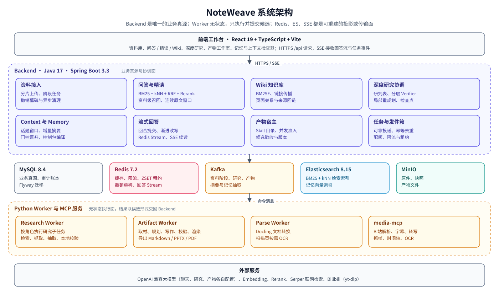

</div>

> 界面截图来自本地真实运行环境：真实上传的资料、真实的模型调用、联网检索和 MCP 工具结果，没有使用演示数据。架构图由 [scripts/diagrams](./scripts/diagrams) 按当前源码生成，图中的类名、阈值和主题名都能在源码里找到。

## 目录

- [系统概览](#系统概览)
- [一、验证驱动、可恢复的 Deep Research Agent](#一验证驱动可恢复的-deep-research-agent)
- [二、任务感知的 QA / Note / Wiki 知识链路](#二任务感知的-qa--note--wiki-知识链路)
- [三、Context 与长期 Memory](#三context-与长期-memory)
- [四、资料异步处理与流式回答](#四资料异步处理与流式回答)
- [五、Schema 驱动的产物生成框架](#五schema-驱动的产物生成框架)
- [技术栈与项目规模](#技术栈与项目规模)
- [快速开始](#快速开始)
- [本地开发与测试](#本地开发与测试)
- [目录结构](#目录结构)

## 系统概览

| 组件 | 职责 |
| --- | --- |
| **Backend**（Java） | 唯一的业务真源：Workspace 隔离与权限、资料版本、研究表与全部判定、产物版本、记忆门控、配额与租约。跨进程任务先写发件箱，再投递 Kafka。 |
| **Research Worker**（Python） | 无状态执行面：按角色领取研究子任务，完成联网检索、网页快照、原文抽取和本地校验，只提交候选与证据。 |
| **Artifact Worker**（Python） | 读取 SKILL.md 与 JSON Schema，执行取材、规划、写作、校验、渲染五个阶段，导出 Markdown、CSV、PPTX 和 PDF。 |
| **Parse Worker**（Python） | 基于 Docling 把 PDF、Office、EPUB 等转换成带页码和位置的结构化文本，扫描页按需 OCR。 |
| **media-mcp**（Python） | MCP 服务：B 站解析、字幕、faster-whisper 转写、抓帧、时间轴和画面 OCR。 |
| **Frontend**（React） | 三栏工作台：导航与对话列表、对话与研究、来源与产物面板；通过 SSE 接收回答流和任务事件。 |
| **存储与中间件** | MySQL 保存真源与审计账本；Elasticsearch 承担 BM25、向量和记忆检索；MinIO 存放大文件和产物；Redis 负责缓存、限流、ZSET 租约、撤销墓碑和回答流的跨实例转发；Kafka 承载各阶段任务。 |

模型调用统一使用 OpenAI 官方 SDK（Java 与 Python），可接入任意兼容 OpenAI 协议的服务。Agent 编排没有使用框架，由 Backend 的状态机驱动；模型在每一步只产出结构化 JSON，便于校验、审计和恢复。Redis、Elasticsearch、SSE 和记忆编译结果都属于投影或传输面，丢失后可以从 MySQL 重建，不会反向覆盖业务事实。

## 一、验证驱动、可恢复的 Deep Research Agent

**要解决的问题**：开放研究容易偏离计划，证据不足时模型倾向于编造结论；多个执行者并发写同一份研究状态时，超时的旧执行者可能覆盖新结果；长任务中断后只能从头再来。

- **研究表（Table-as-State）**：PLANNING 角色给出计划提案，Backend 校验后写成研究表：行是研究对象，列是待验证字段，每个格子独立记录候选、证据、判定和版本号。研究状态全部落在 MySQL 账本里，Worker 不直接修改。
- **规划与重规划**：协调器为缺口格和冲突格生成子任务，命令先写发件箱再投递 Kafka。缺口和失败由已持久化的任务快照推出，触发格级补查；跨格冲突生成有界的反证任务；每格修复次数有上限，每次重规划都审计偏差类型、受影响的格和预算变化。
- **分层 Verifier**：格级给出支持、部分支持、矛盾、证据不足四种判定，模型不可用时如实判为证据不足；全局层检测跨格冲突并标记为 CONFLICTED；引用校验先比对原文片段与数字、日期，再由模型判断引文是否蕴含结论，模型不可用时按词项覆盖度兜底。
- **并发与过期写回**：工作台的研究并发槽位用 Redis ZSET 租约管理，分值是到期时间，过期成员自动回收；子任务有租约代次和 fencing token。完成提交在单一事务里按固定顺序加锁（run → task → 完成记录 → 预算预留 → 格 → 子键），合并格子的 SQL 同时比对格版本、租约代次和 fencing token，过期执行者的写回一律拒绝。
- **检查点与诚实完成**：每一波结束写账本快照和内容摘要，恢复时校验摘要，已验证的格子带入新任务，只重做缺口。只有模型或检索服务不可用才判失败；证据不足属于业务结果，报告列出已核验的事实和每个格子未解决的原因。

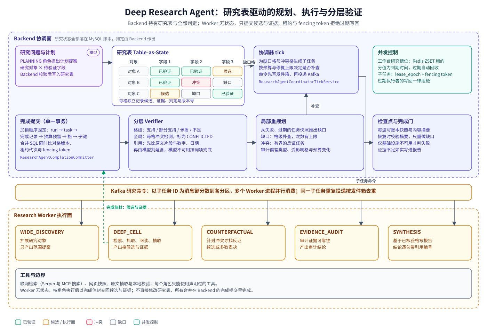

<table>
  <tr>
    <td width="50%">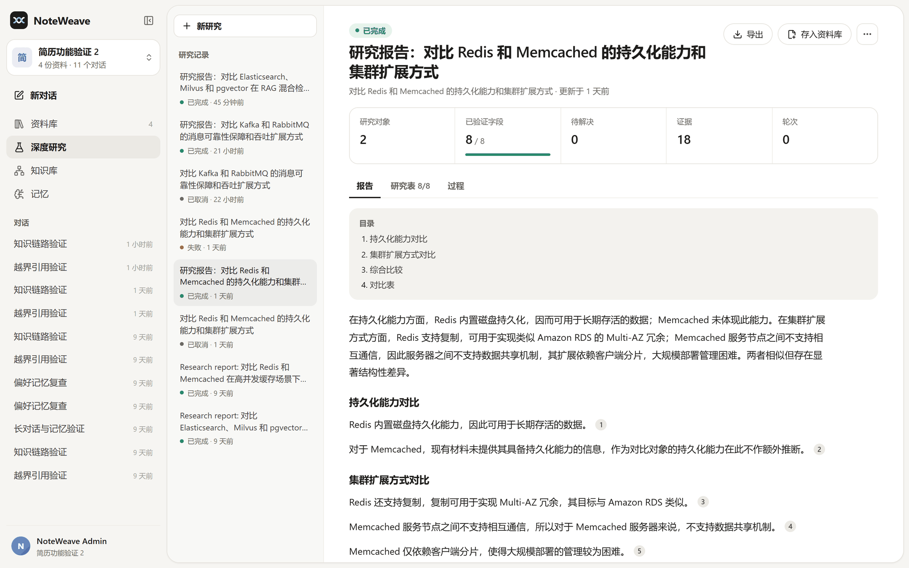<br><sub><b>研究报告</b>：Redis 与 Memcached 对比，8 个字段全部核验，18 条证据，结论逐句带引用编号</sub></td>
    <td width="50%">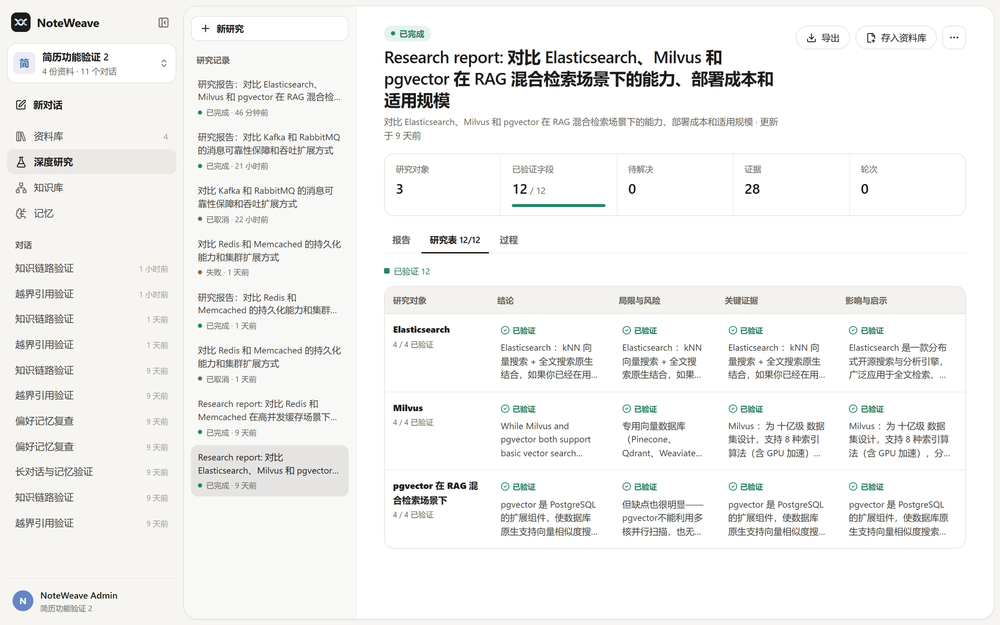<br><sub><b>研究表</b>：Elasticsearch / Milvus / pgvector 三个对象 × 四个字段，12 格全部已验证，28 条证据</sub></td>
  </tr>
</table>

## 二、任务感知的 QA / Note / Wiki 知识链路

**要解决的问题**：单一 RAG 链路无法同时满足快速事实查询、长文档连续阅读和跨资料知识整合；资料撤销后，Elasticsearch 里的片段要异步删除，删除完成前旧片段仍会被召回，还会占掉 TopK 名额。

- **问答**：Elasticsearch 同时做 BM25 与 kNN 召回，两路在线程池里并行执行，RRF 按名次融合；命中少于 3 条时用改写给出的备选查询补召回，再交给 Rerank 精排。交互式回答的重排单次总预算 6 秒，超时会换新连接重试，最终失败后冷却 30 秒，冷却期内直接使用未重排的结果。中文字段使用相邻两字切词的分析器。
- **精读**：先做资料级召回确定相关资料（会话工作集里的资料加权），再用向量命中和重排为候选窗口打分，按原文顺序读取连续窗口，回答会说明窗口覆盖到哪里。
- **Wiki**：资料就绪后经 Kafka 编译成知识页，模型规划放在事务外，短事务复核输入一致后再写入。检索用 BM25F 对标题、摘要、正文分字段加权，得分沿页面链接传播一次，把相连的概念页带进候选；没有页面命中时如实返回空。
- **资料撤销**：撤销提交后按工作台写 Redis 墓碑，ES 查询用 `must_not` 提前排除这些资料，已撤销片段不再占召回名额；召回后按主键批量回查 MySQL，确认资料未删除、快照仍是当前版本，这一步是权威校验，Redis 故障时照样生效；资料目录缓存的键带目录版本号，过期的查询结果只会写到旧版本的键上，不会被读到。
- 三种模式共用证据预算与范围校验，只能引用本工作台、所选资料范围内的证据，证据编号与引用卡片一一对应。

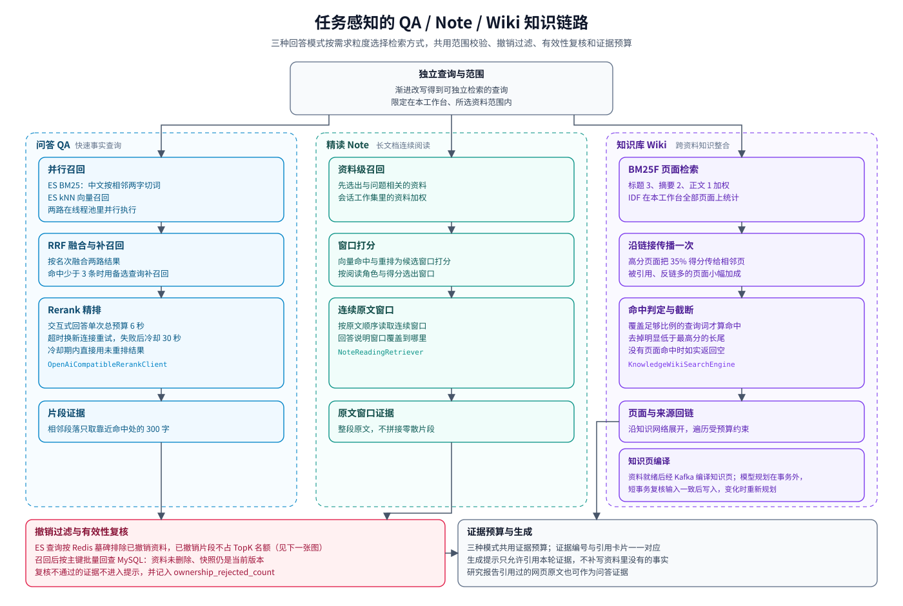

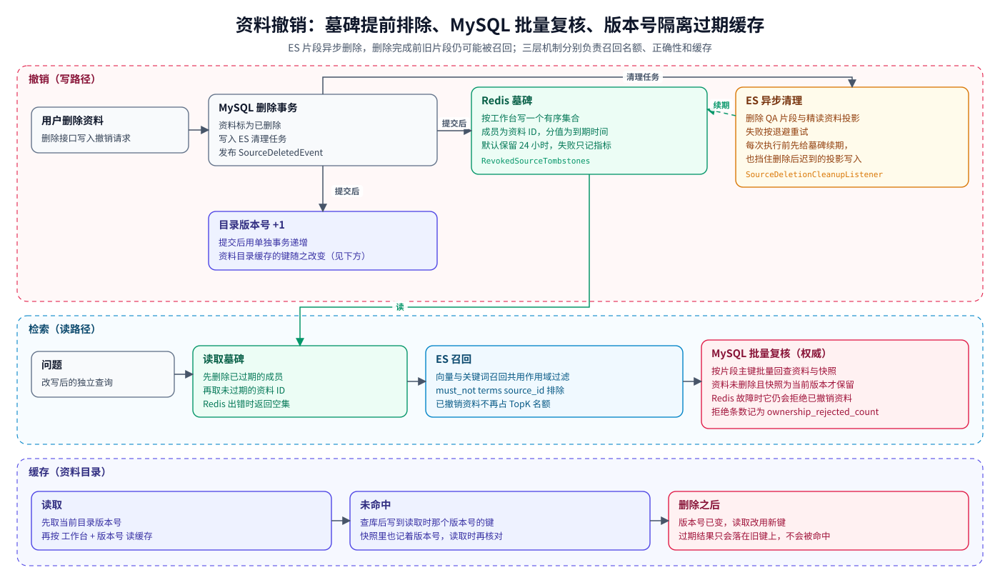

<table>
  <tr>
    <td width="50%">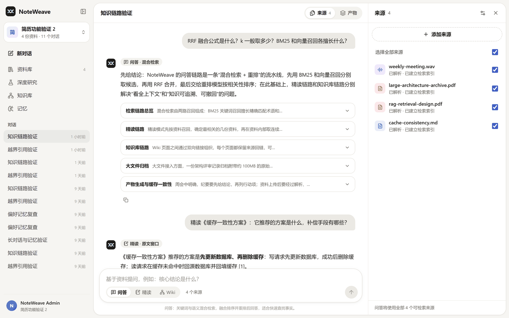<br><sub><b>问答</b>：混合检索回答 RRF 与两路召回的问题，先给结论，再按要点分节展开</sub></td>
    <td width="50%">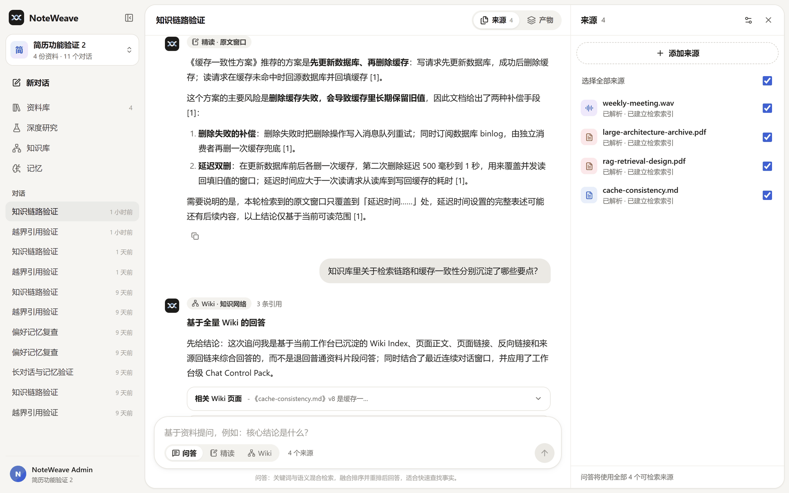<br><sub><b>精读</b>：读取《缓存一致性方案》的原文窗口作答，并说明窗口只覆盖到哪里</sub></td>
  </tr>
  <tr>
    <td colspan="2">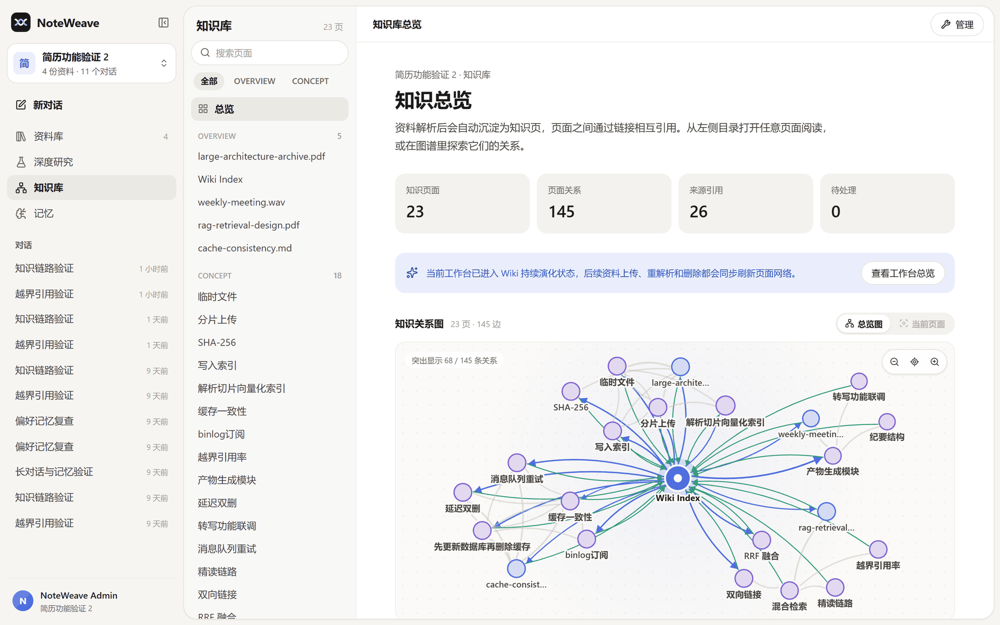<br><sub><b>知识库</b>：4 份资料沉淀出 23 个知识页、145 条页面关系，关系图可交互浏览</sub></td>
  </tr>
</table>

## 三、Context 与长期 Memory

**要解决的问题**：长对话的上下文不断膨胀，全部带上既慢又贵；用户偏好无法跨会话保留，自动抽取的记忆又容易把错误内容带进后续回答。

**上下文**：

- **后台增量维护**：约束抽取、话题切分和话题摘要都在上一轮结束后异步执行，本轮只读取已经落库的结果。约束抽取由模型把用户消息转成增删操作，再由纯函数折叠成整表快照；话题切分用词项 IDF 覆盖度与话题向量余弦初判，回到、改聊、更正这类显式说法优先，不确定的边界每 30 秒交给模型批量复核。
- **按话题压缩**：最近的消息保留原文（2 到 8 条，累计不超过 6000 token 或总预算的一半）；更早的消息由所属话题的摘要覆盖，只选当前话题的摘要，其他话题的摘要不进入。摘要经 Kafka 生成，在上一版摘要上只读新增消息，每一版都不可变；摘要落后 8 条以内时用原文补齐，落后更多时展开当前话题段的原文。
- **冻结与重放**：每轮按用户消息序号冻结输入，窗口规划结果先写入 MySQL，重试和重新生成使用同一份快照；每项内容入选或排除的原因都记录下来，可在上下文检查器中查看。
- **提示拼装**：公共规则、模式规则、最近对话上下文（话题摘要、用户约束、原文尾部）、资料片段、表达控制、当前问题依次拼接。事实只来自资料片段，摘要、约束和记忆只用于理解追问和决定表达方式。

**记忆**：

- **抽取**：回答结束后经 Kafka 异步抽取，先用短分类判断消息里有没有对回答方式的要求或反馈，再做结构化抽取。槽位只取模型输出，限定在 8 个受控槽位（语言、篇幅、风格、约束、结构、表格、术语、交互方式）；用户消息包在数据围栏里，输出不合规时整批作废。
- **冲突与门控**：同一槽位的记忆直接比较取值与极性，没有同槽位时查记忆向量 Top5 交给模型判定。候选还要通过证据置信度、预期效用、风险、范围四项门控，全部通过才自动生效；冲突或冲突检查没跑成都会阻断自动生效，转为待确认。确认后旧记忆标为已替代并记下失效时间，历史版本保留。
- **编译与缓存**：风格、结构、禁忌、交互类记忆每轮都带，术语类按问题相关度选入（向量与 BM25 各排一次，RRF 融合）；按置信度 × 效用 × 相关度 × 新近度计算价值，按价值除以篇幅装入预算。编译结果按策略版本和记忆状态指纹缓存在 Redis，记忆一变缓存自然失效。
- **效果反馈**：每次回答记下实际注入的记忆版本，点赞点踩、重新生成、下一轮追问和产物编辑都记到这些记忆上；负反馈、效用持续偏低或不良比例过高的记忆退回待确认。后台定期合并近似重复的记忆。

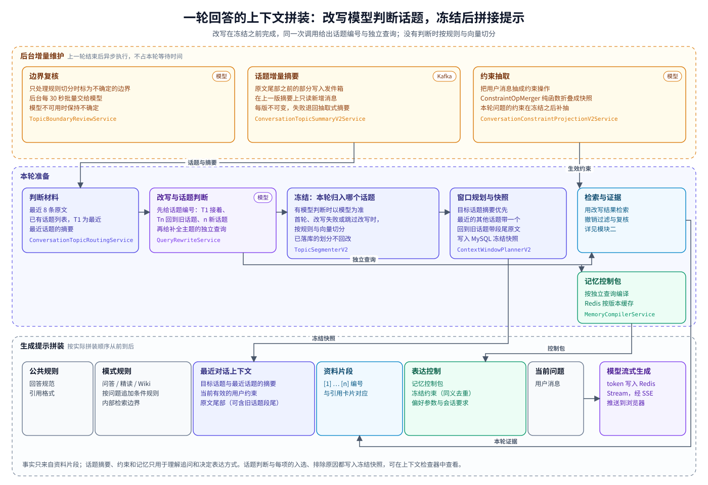

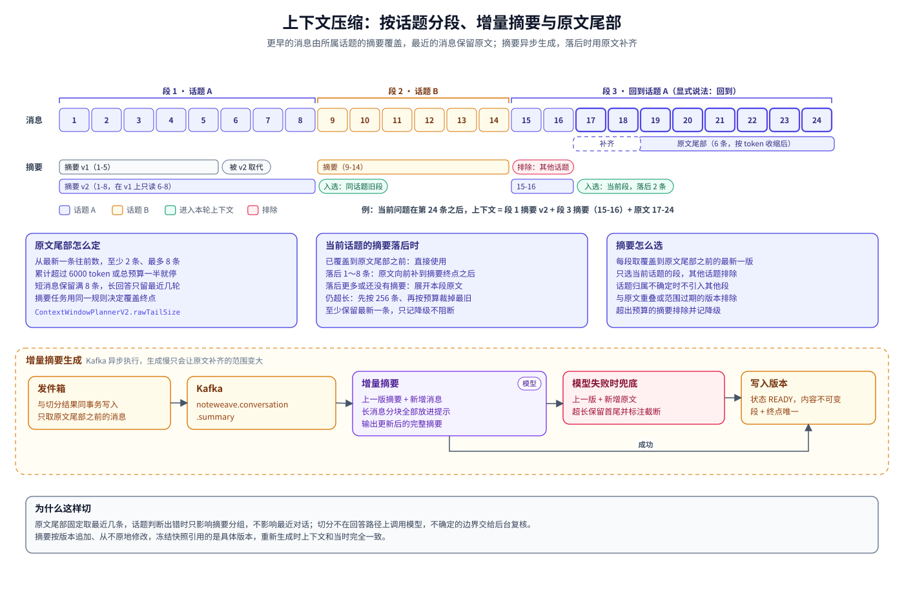

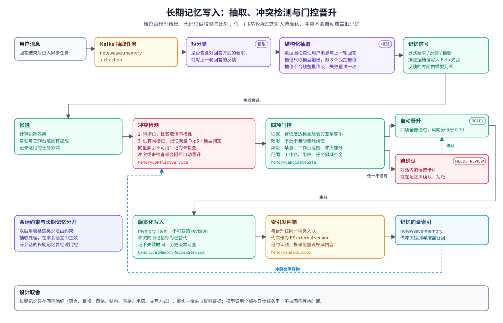

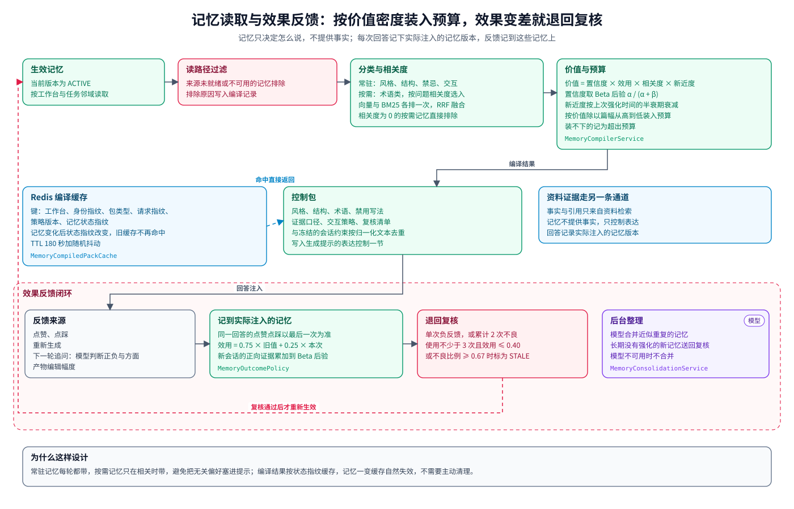

<table>
  <tr>
    <td width="50%">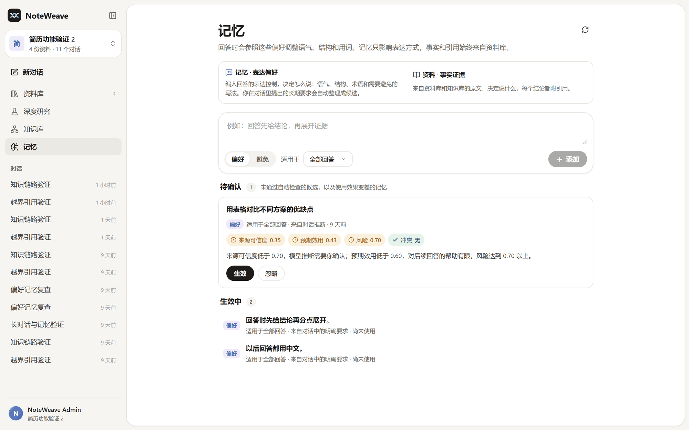<br><sub><b>记忆</b>：一条模型推断的候选未通过门控，等待确认；两条明确要求已生效</sub></td>
    <td width="50%">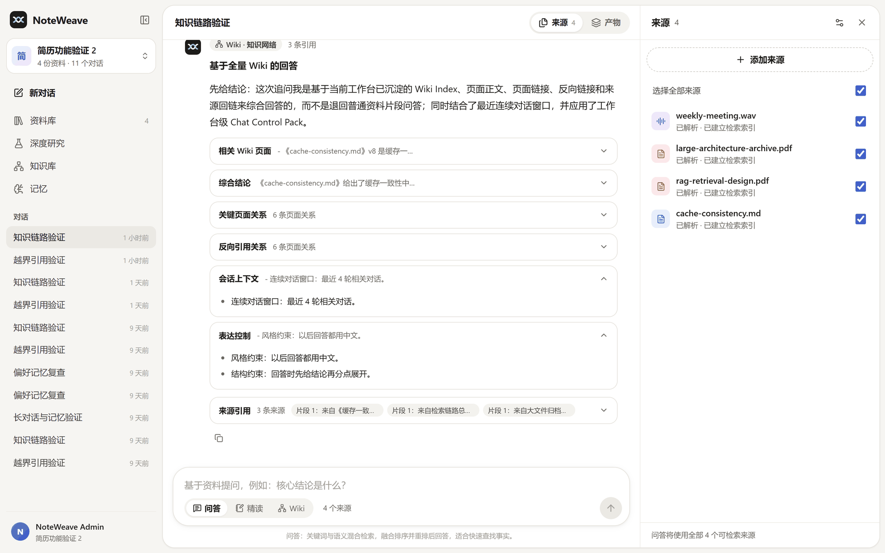<br><sub><b>回答时实际使用的上下文</b>：最近几轮相关对话，以及由生效记忆编译出的风格与结构约束</sub></td>
  </tr>
</table>

## 四、资料异步处理与流式回答

**要解决的问题**：大文件同步处理会占住请求线程，资料链路长，任一阶段失败都难以定位和恢复；回答流在多实例部署下会断在别的实例上，网络中断后需要从断点续读。

**资料流水线**：

- 分片上传，单文件最大 128 MB，流式读取，缓冲区大小固定，边读边校验格式与大小。
- 解析、切片、向量化、索引拆成四个 Kafka 阶段，阶段之间只传资料快照 ID，大对象通过 MinIO 交接。文档由 Parse Worker（Docling）转换，扫描页按需 OCR；音视频交给 media-mcp 转写，再由模型逐批校对识别错误。
- 阶段任务与业务数据在同一事务写入发件箱；各阶段按幂等键去重，索引失败记录下次重试时间并退避重试，失败进入死信并回写资料状态。检索投影全部写完才对检索可见。

**流式回答**：

- 发消息接口写入用户消息和回答占位后立即返回，冻结、改写、检索、记忆编译在后台执行，阶段进度作为事件推送。
- 每个回答一条 Redis Stream：Lua 脚本用 INCR 分配单调序号并 XADD 写入，超过 512 条时删除最旧的事件，记下已裁剪的位置。任意实例都能按序号读取并转发成 SSE，事件 id 就是序号；每个订阅者一条串行队列，慢消费者不会拖累其他人。
- 断线重连时浏览器带上 Last-Event-ID，从 Stream 读取序号之后的事件，与本地回放合并去重后补发；游标早于已裁剪的位置时返回 409，前端改从 MySQL 的最终快照恢复。回答正文以 MySQL 为准，Redis 丢失只影响实时性。

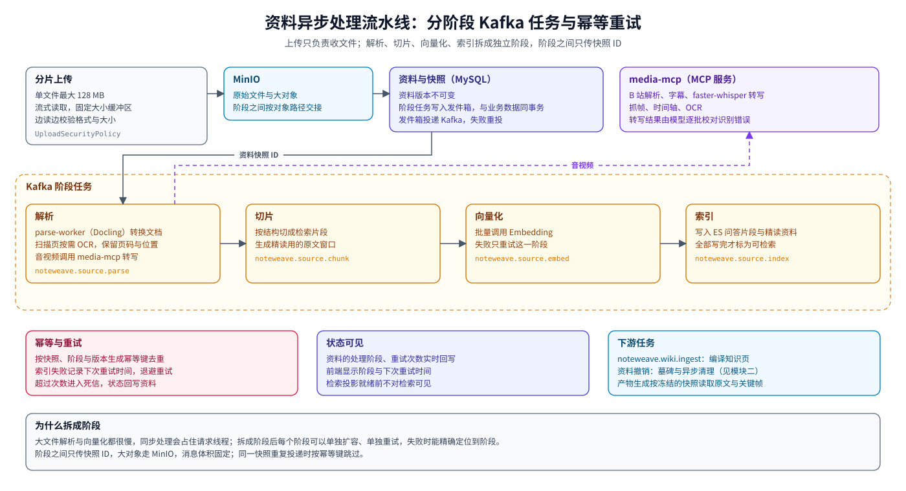

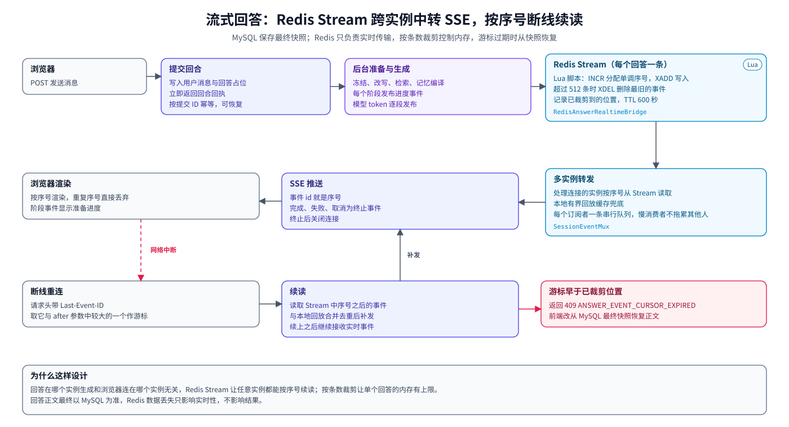

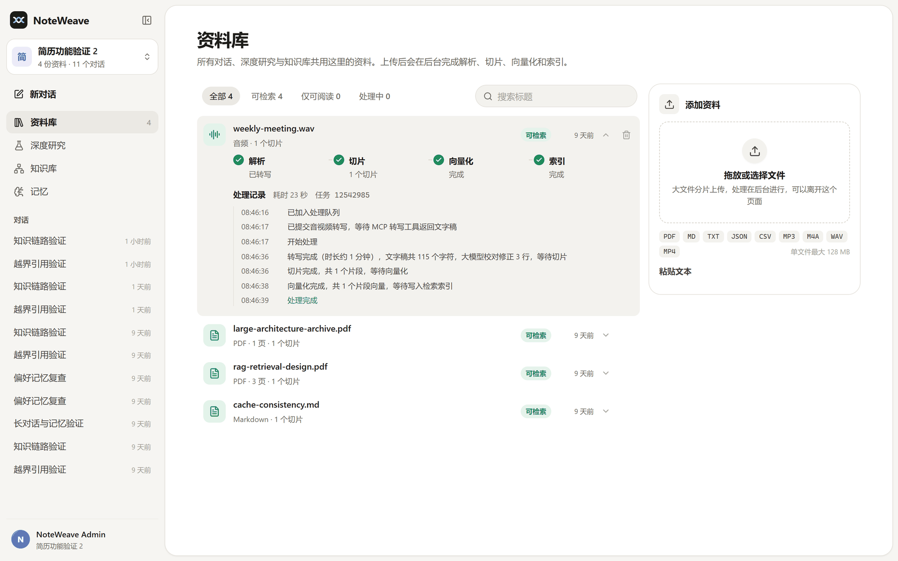
<sub><b>资料库</b>：一段会议录音的处理记录，依次经过 MCP 转写（大模型校对修正 3 行）、切片、向量化、索引</sub>

## 五、Schema 驱动的产物生成框架

**要解决的问题**：报告、测验、导图、讲义等产物各写一套提示词和流程，难以复用，结果也无法校验；产物任务耗时长，多个任务同时运行会互相挤占资源。

- **Skill 目录声明产物**：`skills/<name>/SKILL.md` 定义形态、用户可选项和输出契约，`schemas/` 定义内容结构，Host 与 Worker 读取同一目录；新增同形态产物只需增加一个 SKILL.md。目前有 14 种产物。
- **Java Host 管控**：按 Skill 声明校验选项，没有给数量时从需求原文推断；冻结来源资料的版本；工作台并发用 Redis ZSET 租约限制（默认每个工作台 4 个，租约 300 秒），超出时排队并显示位置；任务与发件箱同事务写入，经 Kafka 投递，失败进入死信队列。
- **Python Worker 五段流水线**：取材、规划、写作、校验、渲染共用一套代码，多条消费通道并行处理任务。模型输出须通过 Schema、引用和数字一致性校验，不通过时修复一次；Host 收到候选后再校验引用是否属于冻结的来源、核对文件清单，然后生成产物版本。
- **视频资料**：media-mcp 解析音视频并生成转写与关键帧；演示文稿每页配视频原画面并标注时间点与字幕证据，PDF 讲义插入关键帧并用 XeLaTeX 编译。产物可以写回 Note，旧版本可以恢复。

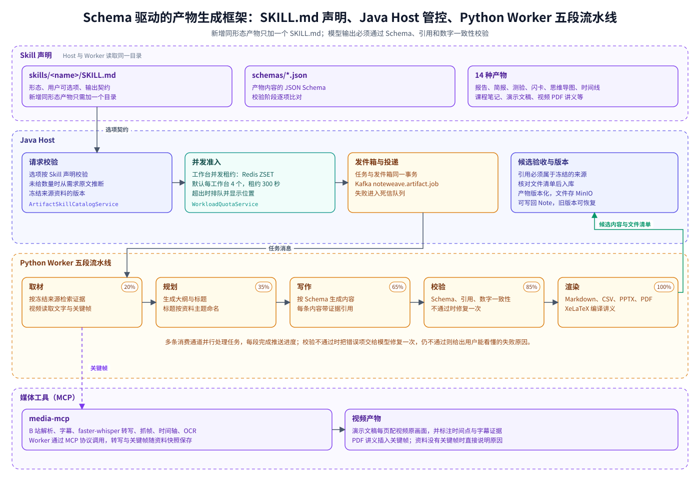

<table>
  <tr>
    <td width="50%">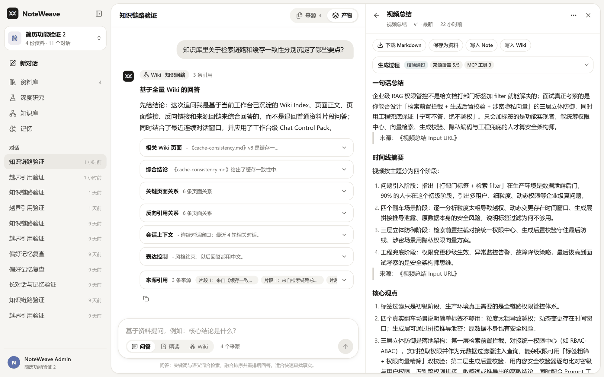<br><sub><b>视频摘要</b>：生成过程显示校验通过、来源覆盖 5/5、调用 MCP 工具 3 个</sub></td>
    <td width="50%">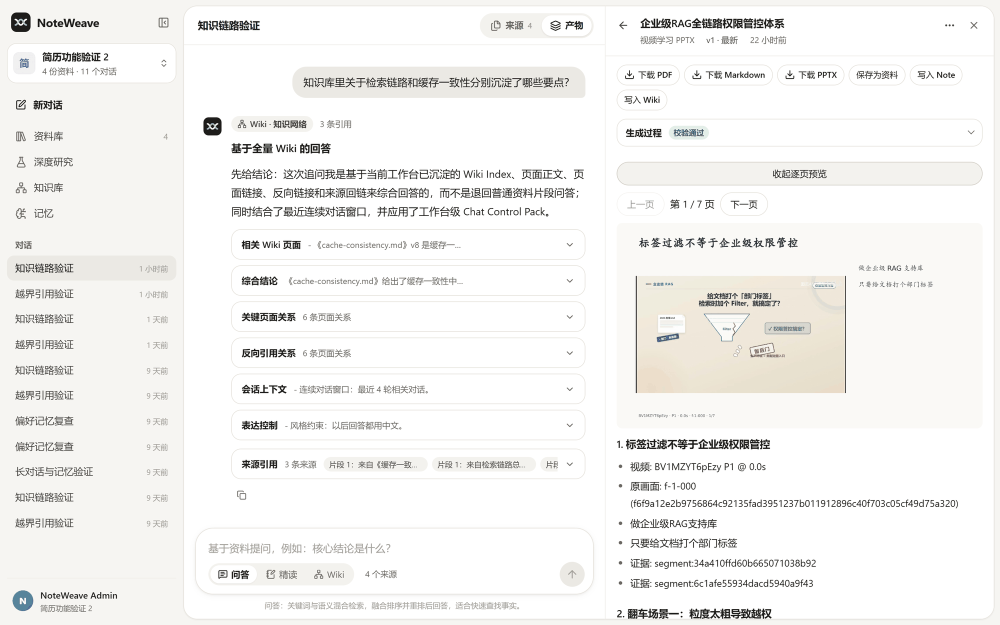<br><sub><b>学习 PPTX</b>：逐页预览，每页配视频原画面，并标注视频时间点与字幕证据</sub></td>
  </tr>
  <tr>
    <td width="50%">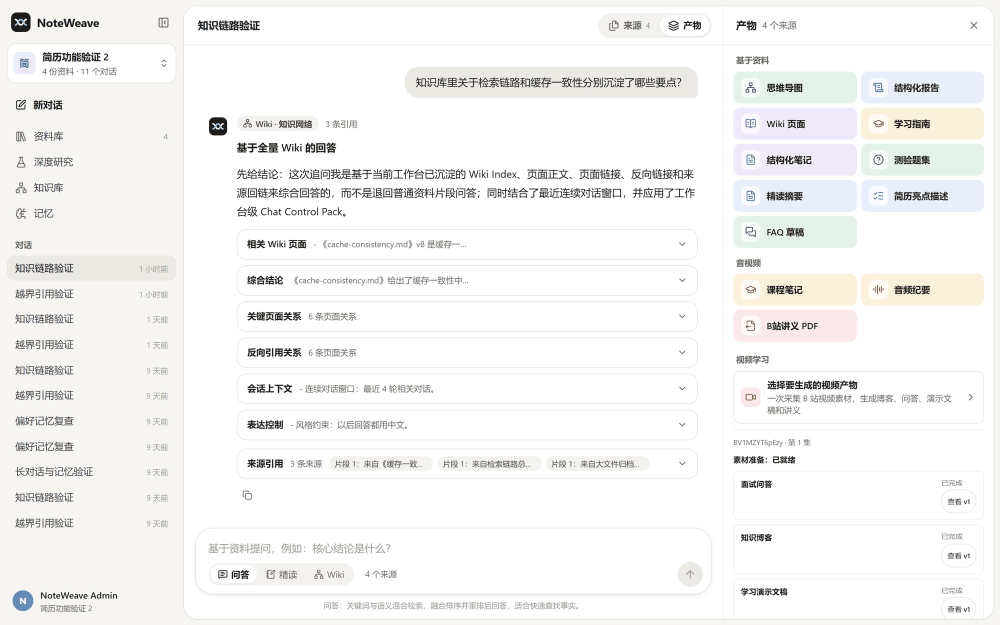<br><sub><b>产物面板</b>：从选定资料生成报告、讲义和幻灯片，提供历史版本与文件下载</sub></td>
    <td width="50%">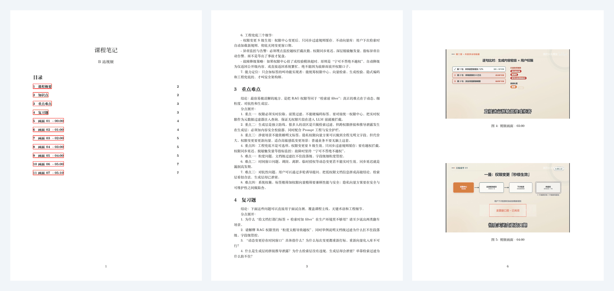<br><sub><b>PDF 讲义</b>：XeLaTeX 编译的课程笔记，包含目录、知识点、复习题和带时间点的视频画面</sub></td>
  </tr>
</table>

## 技术栈与项目规模

| 组件 | 实现 |
| --- | --- |
| Backend | Java 17、Spring Boot 3.3、Spring JDBC、Flyway、OpenAI Java SDK |
| Frontend | React 19、TypeScript 5、Vite 5，Nginx 托管 |
| Research Worker | Python 3.12、Pydantic、kafka-python、OpenAI Python SDK |
| Artifact Worker | Python 3.12、FastAPI、OpenAI Python SDK、MCP Python SDK、XeLaTeX、python-pptx |
| Parse Worker | Python 3.12、Docling、RapidOCR |
| media-mcp | Python 3.12、MCP Python SDK、faster-whisper、yt-dlp |
| 存储与中间件 | MySQL 8.4、Redis 7.2、Kafka、MinIO、Elasticsearch 8.15 |
| 外部服务 | OpenAI 兼容大模型、Embedding、Rerank、Serper 联网检索 |

| 模块 | 源码规模 | 自动化测试 |
| --- | --- | --- |
| Backend | 约 12 万行 Java，185 个 Flyway 迁移 | 约 2500 个测试方法 |
| Research Worker | 约 3.2 万行 Python | 924 个测试 |
| Artifact Worker | 约 4000 行 Python | 132 个测试 |
| Frontend | 约 4.1 万行 TypeScript | 约 430 个组件与单元测试，另有真实环境 Playwright E2E |

## 快速开始

需要 Docker 与 Docker Compose。在仓库根目录复制环境变量示例：

```powershell
Copy-Item .env.example .env
```

至少替换 `.env` 中的数据库、Redis、Kafka、Elasticsearch、MinIO 密码、内部服务令牌和 Bootstrap 账号密码，再填写大模型与检索服务配置。然后启动完整应用：

```powershell
docker compose --profile app up --build -d
docker compose --profile app ps
```

浏览器打开 `http://localhost:3000`，用 Bootstrap 账号登录。前端由 Nginx 托管，同源 `/api` 请求转发到 Backend（容器端口 `8081`）。不带 `--profile app` 时只启动 MySQL、Redis、Kafka、MinIO 和 Elasticsearch。

聊天问答、深度研究和产物生成分别读取各自的大模型配置，可以接入不同的服务：

| 用途 | 主要变量 |
| --- | --- |
| 聊天问答 | `NOTEWEAVE_LLM_ENDPOINT`、`NOTEWEAVE_LLM_API_KEY`、`NOTEWEAVE_LLM_MODEL` |
| 深度研究 | `NOTEWEAVE_RESEARCH_LLM_BASE_URL`、`NOTEWEAVE_RESEARCH_LLM_API_KEY`、`NOTEWEAVE_RESEARCH_LLM_MODEL` |
| 产物生成 | `NOTEWEAVE_ARTIFACT_LLM_BASE_URL`、`NOTEWEAVE_ARTIFACT_LLM_API_KEY`、`NOTEWEAVE_ARTIFACT_LLM_MODEL` |
| 向量与重排 | `NOTEWEAVE_EMBEDDING_*`、`NOTEWEAVE_RERANK_*` |
| 联网检索 | `NOTEWEAVE_RESEARCH_SEARCH_*` |

其他常用开关：`NOTEWEAVE_RESEARCH_AGENT_MAX_CONCURRENCY`（研究 Worker 并行消费进程数）、`NOTEWEAVE_RESEARCH_CHECKPOINT_HYDRATION_V2`（从检查点恢复并复用已验证的格子）、`NOTEWEAVE_VIDEO_LEARNING_ENABLED`（开启 B 站视频学习入口）、`NOTEWEAVE_QUOTA_CONCURRENCY_LIMIT`（每个工作台的研究与产物并发上限）。完整演示前可以检查配置是否齐全：

```powershell
.\scripts\smoke-compose-provider-readiness.ps1 -EnvFile .env -RequireFullDemo
```

### 会话路由请求头

Chat、Research Worker 和 Artifact Worker 会自动向兼容模型端点发送 `X-Session-ID`，无需在界面中额外填写：

- 聊天使用 Workspace 与持久化 Conversation ID，多轮消息保持一致。
- Research 使用 Research Run ID；分布式子 Agent 使用 Research Run 与逻辑 Task ID，租约重试不会更换 ID。
- Artifact 使用 Artifact Job ID，生成、修订和同一 Job 的恢复共享 ID。

发送的值经过 SHA-256 摘要，不包含原始业务 ID。端点侧仍需支持会话固定路由，这个请求头本身不保证模型缓存命中。

## 本地开发与测试

```powershell
# Backend
.\mvnw.cmd -f backend\pom.xml spring-boot:run

# Frontend
Set-Location frontend
corepack enable
pnpm install --frozen-lockfile
pnpm dev
```

只想看界面时，在 `frontend/.env.local` 写入 `VITE_NOTEWEAVE_MOCK=1`，前端会使用内置的演示数据，不需要启动后端。Python Worker 的环境与启动方式见 [workers/README.md](./workers/README.md)。新增同形态产物时，在 `skills/` 下增加 SKILL.md；新增形态时同步补充 Schema、提示词和渲染器。

```powershell
# Backend 全量测试
.\mvnw.cmd -f backend\pom.xml test

# Frontend 单元测试、类型检查与构建
Set-Location frontend
pnpm test
pnpm build

# Worker 测试
.\workers\scripts\test-workers.ps1

# 真实浏览器 E2E（需要先启动完整 Compose 环境）
Set-Location frontend
corepack pnpm e2e

# 重新生成 README 架构图（只依赖 Python 标准库）
python scripts\diagrams\build_readme_diagrams.py
```

## 目录结构

```text
NoteWeave
├── backend                  Java 主系统、Flyway 迁移和后端测试
├── frontend                 React 工作台、演示数据、组件测试和 Playwright E2E
├── workers
│   ├── research-worker      深度研究执行面
│   ├── artifact-worker      产物生成与导出
│   ├── parse-worker         文档解析（Docling）
│   └── media-mcp            音视频 MCP 服务（字幕、转写、抓帧、OCR）
├── skills                   产物 SKILL.md 定义
├── schemas                  产物形态 JSON Schema
├── scripts                  运行、评测、冒烟脚本与架构图生成脚本
└── docs/images              架构图与界面截图
```
