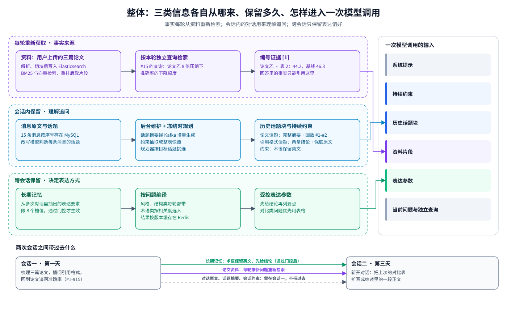
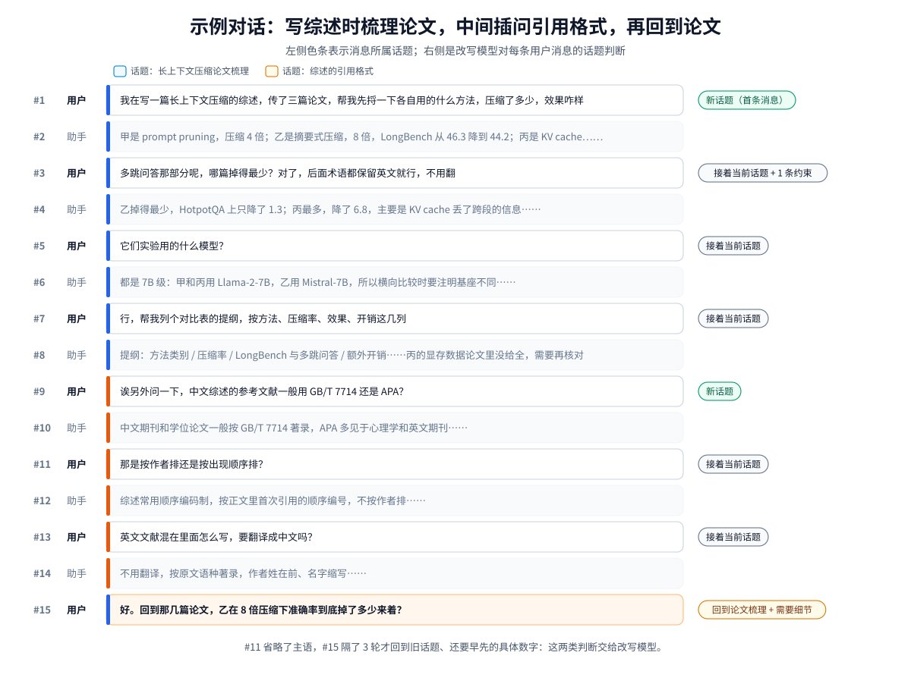
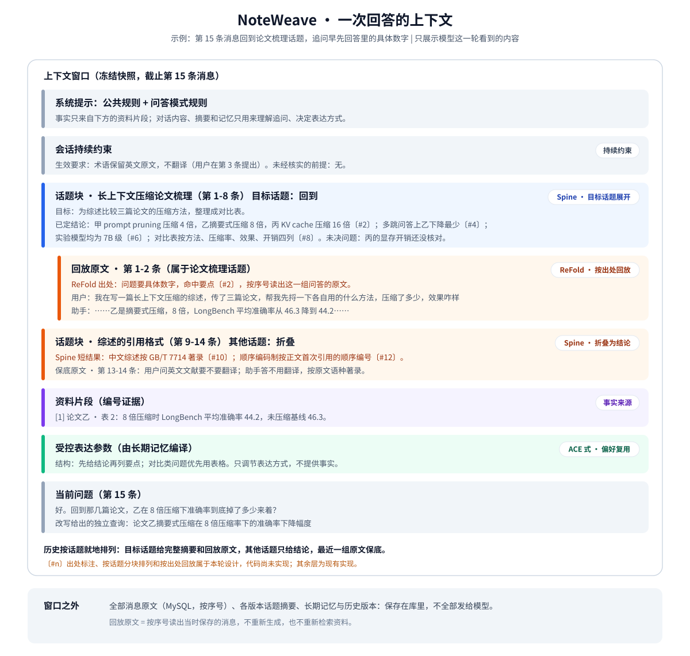
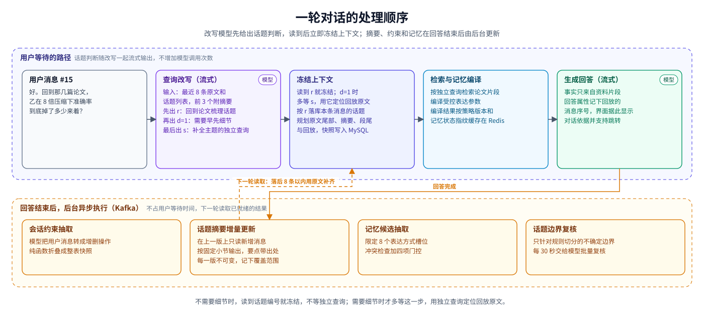
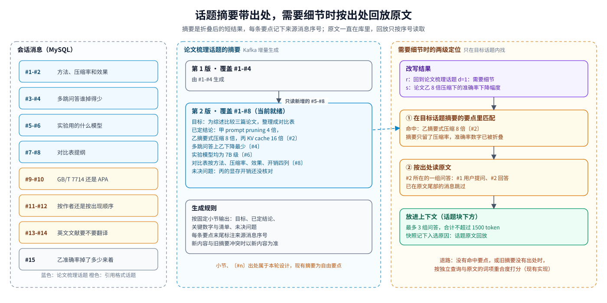
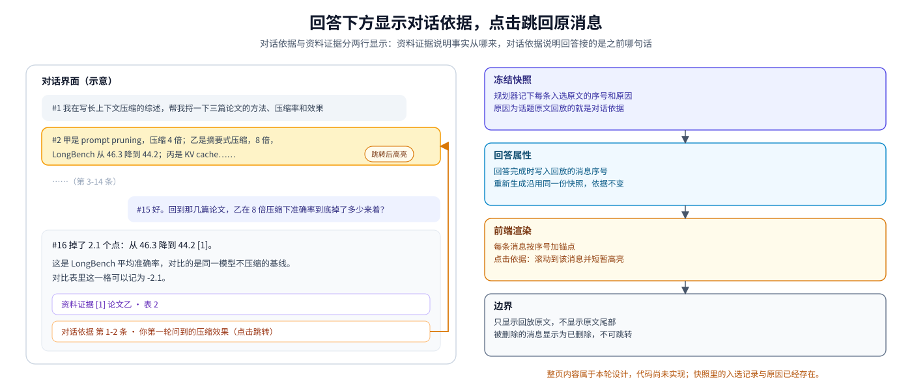
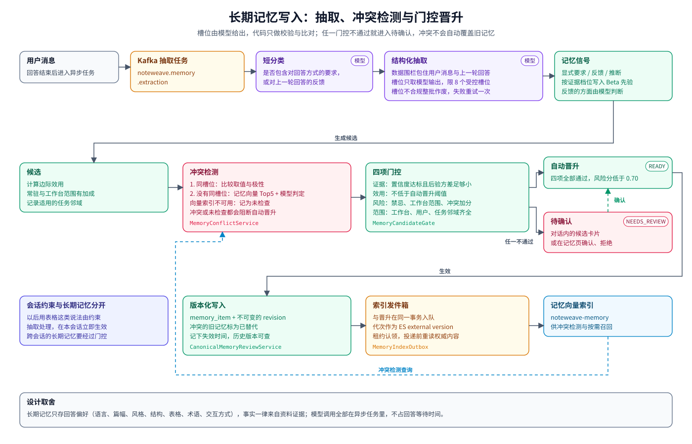
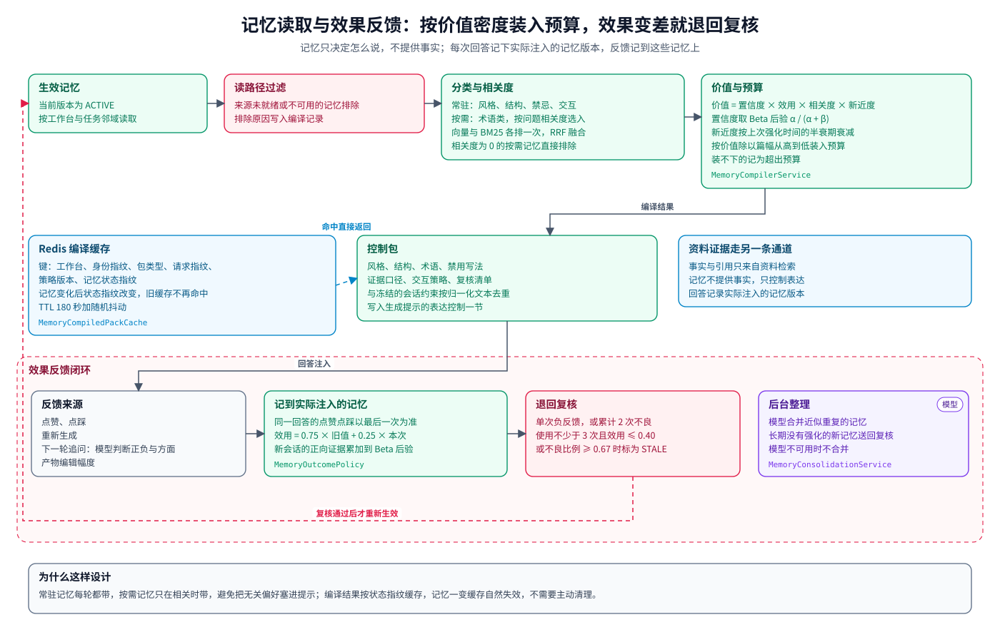

# 会话上下文与长期记忆设计

本文说明 NoteWeave 在多轮对话中怎样组装每一轮发给模型的上下文，以及长期记忆怎样参与回答。文中用一位用户写综述的两次会话贯穿始终，对话、论文名和数字都是按设计编写的示例。

图和正文里标注为本轮设计的部分，包括摘要要点带出处、按出处回放、按话题分块排列、对话依据跳转，代码尚未实现；其余为现有实现。第九节列出逐项状态。

## 一、设计思路

我们参考了 Spine、ReFold、ACE 三种上下文压缩与经验复用的思路。

**思路：根据当前问题判断哪个话题继续展开、哪些话题折叠为短结果（Spine）；为折叠内容保留原文出处，需要时按出处取回（ReFold）；再加入与表达方式相关的长期偏好，组装本轮的模型输入（ACE）。**

| 机制 | 在我们的方案中负责什么 | 最终进入上下文的内容 |
| --- | --- | --- |
| **Spine** | 由查询改写模型判断本轮问题接着哪个话题；目标话题展开，其他话题折叠为结论 | 目标话题的完整摘要，其他话题的已定结论，最近一组原文 |
| **ReFold** | 话题摘要的每条要点记下来源消息序号；问题需要原话或数字时，按序号取回原文 | 挂在目标话题下的回放原文，最多 3 组问答 |
| **ACE** | 从对话和用户反馈中提炼表达偏好，经门控生效，按效果反馈降级 | 编译后的少量表达参数 |

这三种思路原本面向编码 Agent 的任务轨迹。放到多轮问答里，子任务对应话题，当前活动分支对应本轮问题所属的目标话题，指向实验和日志的存储引用对应消息序号，跨任务的经验对应跨会话的表达偏好。

**Spine 与 ReFold 共同服务于当前会话的压缩与追问；ACE 负责跨会话的偏好复用。** Spine 式折叠得到的短结果和 ReFold 式出处写在同一份话题摘要里；ACE 式偏好单独编译成表达参数，和事实来源分开。

## 二、整体：一个用户的两次会话

一位研究生在写长上下文压缩方向的综述：

- **第一天，会话一**：上传了三篇论文，先让助手梳理各自的方法和效果，中途插问了几句中文综述的引用格式，最后回到论文，追问某个准确率数字。
- **第三天，会话二**：新开一个对话，让助手把上次整理的对比表扩写成综述里的一段正文。

在这个过程里，模型每一轮看到的信息分三类，来源、保存位置和保留时长各不相同：



| 信息 | 从哪来 | 保存在哪 | 保留多久 | 怎样进入上下文 | 用来做什么 |
| --- | --- | --- | --- | --- | --- |
| 资料片段 | 用户上传的论文 | Elasticsearch 与 MySQL | 资料删除前一直有效 | 每轮按独立查询重新检索 | 回答里事实的唯一来源 |
| 消息原文 | 对话本身 | MySQL，按消息序号 | 会话内 | 最近原文、回到旧话题时的段尾、按出处回放 | 理解追问 |
| 话题摘要 | 后台经 Kafka 增量生成 | MySQL，每版不可变 | 会话内 | 目标话题给完整摘要，其他话题给结论 | 理解追问 |
| 持续约束 | 用户在会话里明确提出的要求 | MySQL，整表快照 | 会话内 | 每轮都带 | 约束回答方式 |
| 长期记忆 | 从对话和反馈中抽出的表达要求 | MySQL 与 Elasticsearch，Redis 缓存编译结果 | 跨会话 | 编译成表达参数 | 决定表达方式 |

这张表就是整个设计的边界：**事实每轮从资料重新取，对话内容只在会话内帮助理解追问，跨会话只保留表达方式。** 第三节到第七节分别展开这三类信息。

## 三、会话一：话题切换与回到旧话题

### 3.1 对话全貌



这段对话有两处难点，都交给改写模型判断：

- **#11 省略了主语**：用户问那是按作者排还是按出现顺序排，没说排什么。改写模型从最近的原文看出接着引用格式话题，补全成独立查询：中文综述参考文献的排序规则。这一轮不需要早先的细节，读到话题编号就冻结。
- **#15 隔了 3 轮才回到旧话题**：而且问的是早先回答里的一个具体数字，这个数字在摘要里已经被折叠掉了。

下面用 #15 走一遍完整过程。

### 3.2 第一步：改写模型判断话题

改写模型的输入是最近 8 条原文，加上已有话题的列表（最近 3 个话题附摘要）：

```text
话题列表：
T1（最近在聊）综述的引用格式：中文综述按 GB/T 7714 著录；顺序编码制按首次引用顺序编号……
T2 长上下文压缩论文梳理：甲 prompt pruning 4 倍，乙摘要式压缩 8 倍，丙 KV cache 16 倍……

最近原文：#8 至 #14
当前问题：好。回到那几篇论文，乙在 8 倍压缩下准确率到底掉了多少来着？
```

输出按固定顺序流式给出（示意，省略其余字段）：

```text
r = T2        回到论文梳理话题
d = 1         需要早先回答里的具体数字
s = 论文乙摘要式压缩在 8 倍压缩率下的准确率下降幅度
```

r 最先到达。系统读到 r 就知道目标话题；因为 d=1，再多等一步拿到 s，用它定位要回放的原文。如果 d=0，读到 r 就直接冻结，不等后面的字段。

### 3.3 第二步：冻结并规划上下文

规划器按 r 和 s 从库里挑选内容，写成冻结快照。生成回答的模型最终拿到的历史部分如下：

```text
## 生效要求
- 术语保留英文原文，不翻译（第 3 条）

## 会话历史
### 话题：长上下文压缩论文梳理（第 1-8 条）  本轮回到这个话题
话题摘要：
- 目标：为综述比较三篇论文的压缩方法，整理成对比表
- 已定结论：甲 prompt pruning 压缩 4 倍，乙摘要式压缩 8 倍，丙 KV cache 压缩 16 倍〔#2〕
- 多跳问答上乙下降最少〔#4〕；实验模型均为 7B 级〔#6〕
- 对比表按方法、压缩率、效果、开销四列〔#8〕
- 未决问题：丙的显存开销还没核对
回放原文（第 1-2 条）：
用户：我在写一篇长上下文压缩的综述，传了三篇论文，帮我先捋一下各自用的什么方法，压缩了多少，效果咋样
助手：甲是 prompt pruning，压缩 4 倍；乙是摘要式压缩，8 倍，LongBench 从 46.3 降到 44.2；丙是……

### 话题：综述的引用格式（第 9-14 条）
已定结论：中文综述按 GB/T 7714 著录〔#10〕；顺序编码制按正文首次引用的顺序编号〔#12〕
最近原文（第 13-14 条）：
用户：英文文献混在里面怎么写，要翻译成中文吗？
助手：不用翻译，按原文语种著录，作者姓在前、名字缩写……

## 资料片段
[1] 论文乙 · 表 2：8 倍压缩时 LongBench 平均准确率 44.2，未压缩基线 46.3。

## 表达方式
- 先给结论再列要点；对比类问题优先用表格
```

同一份内容画成图如下：



### 3.4 第三步：生成回答

```text
掉了 2.1 个点：LongBench 平均准确率从 46.3 降到 44.2 [1]。
这是和同一模型不压缩的基线比较的结果，对比表里这一格可以记为 -2.1。

资料证据：[1] 论文乙 · 表 2
对话依据：第 1-2 条（你第一轮问到的压缩效果）
```

数字引用的是资料片段 [1]，回放的原文只帮助模型确认，用户说的乙和 8 倍指的是第一轮梳理过的那篇论文和那组实验。

### 3.5 三个机制在这一轮各自做了什么

- **Spine 式折叠**：引用格式的讨论已经告一段落，不必让模型每轮重读完整过程，只保留两条结论。论文梳理是本轮的目标话题，给完整摘要。最近一组原文 #13-#14 仍然保留，即使话题判断出错，刚说过的内容也不会丢。
- **ReFold 式回查**：摘要只记下了乙用摘要式压缩、压缩率 8 倍，具体准确率在折叠时省略了，但这条要点标着出处〔#2〕。问题要的是具体数字，系统就按〔#2〕读出第一轮那组问答的原文，不需要把整段对话放回上下文。
- **ACE 式偏好复用**：用户过去多次要求先给结论、对比类问题用表格，这两条偏好已经通过门控，编译成表达参数带入本轮。它们只影响回答的组织方式。

因此，压缩后模型看到的内容是：

> **论文梳理话题的完整摘要和第一轮原文 + 引用格式话题的两条结论和最近一组原文 + 论文乙的实验结果片段 + 两条表达偏好。**

## 四、会话二：新开对话时带过去什么

第三天，用户新开一个对话：把上次那个对比表扩写成综述里的一段正文。

这时模型拿到的上下文如下：

```text
## 表达方式
- 先给结论再列要点；对比类问题优先用表格
- 术语保留英文原文

## 资料片段
[1] 论文甲 · 方法……  [2] 论文乙 · 表 2……  [3] 论文丙 · 实验设置……

## 当前问题
把上次那个对比表扩写成综述里的一段正文
```

和会话一相比：

- **带过来的**：
  - 表达偏好。术语保留英文在会话一里先作为持续约束立即生效；后台同时把它抽成记忆候选，通过门控后成为长期记忆，会话二也会带上。
  - 论文资料。按新问题重新检索。
- **没有带过来的**：会话一的原文、话题摘要和会话约束。会话二里，模型并不知道上次的对比表长什么样，只能根据三篇论文重新整理对比内容。

这样设计的原因：对比表里的数字和结论都出自论文，从资料重新取，能保证每个数字都附有资料引用。如果把会话一得出的结论当成记忆跨会话复用，未经核实的内容就会绕过资料证据进入回答，这正是自动记忆污染事实的来源。

## 五、一轮对话的处理顺序



- **话题判断合并进查询改写**：
  - 追问常省略主语，本来就要调用模型改写成独立查询。改写模型的输入是最近 8 条原文和最多 8 个已有话题，按 r、d、s 的顺序流式输出。
  - 话题判断不需要额外的模型调用。
  - 不需要细节时，读到 r 就冻结；需要细节时才多等 s。
- **模型判断失效时的退路**：
  - 模型没有给出判断，或者给出的话题不存在时，按词项 IDF 覆盖度和话题向量的余弦相似度切分。
  - 回到、改聊、更正这类明确说法优先。
  - 规则切分中不确定的边界，每 30 秒交给模型批量复核。
  - 已经落库的划分不会回头修改。
- **冻结快照**：每轮按用户消息的序号冻结输入，规划结果先写入 MySQL，重试和重新生成都使用同一份快照。每项内容入选或被排除的原因都会记录下来。
- **预算**：
  - 最近原文保留 2 到 8 条，累计不超过 6000 token，也不超过总预算的一半；
  - 目标话题的摘要优先，最近的其他话题再带一个；
  - 回到旧话题时，摘要还没覆盖到的段尾原文最多带 4 条；
  - 回放原文最多 3 组问答，合计不超过 1500 token。
- **后台更新**：
  - 约束抽取、话题摘要和记忆抽取都在回答结束后经 Kafka 异步执行。本轮问题里的约束在冻结之后补抽。
  - 当前话题的摘要落后 8 条以内时用原文补齐，落后更多时展开当前话题段的原文。

## 六、话题摘要与按出处回放



**摘要怎么生成**

- 每个话题的摘要经 Kafka 增量生成：在上一版摘要的基础上，只读新增的消息。
- 每一版都不可变，并记下覆盖的消息范围。新增内容与旧摘要冲突时，以新增内容为准。
- 本轮设计把摘要改为按固定小节输出：目标、已定结论、关键数字与清单、未决问题。每条要点末尾标注来源消息序号。现有摘要是不超过 800 字的自由要点，没有逐条出处。

**两级定位**

1. 用独立查询在目标话题摘要的要点里做词项匹配，找到最相关的要点。
2. 取这条要点标注的消息所在的那一组问答。已经在原文尾部的消息会跳过。

匹配不到要点，或者旧摘要没有出处时，退回现有做法：用独立查询和目标话题的历史原文计算词项重合度并打分。中文按两字切词，按 IDF 加权。

先在要点上匹配，是因为摘要由模型统一措辞，用户换一种说法提问时，比直接在原始对话里匹配更稳定。要点命中后取回的是完整的一组问答，模型能看到当时问了什么、答了什么。回放只在目标话题内进行，不跨话题。

**为什么由系统预先取回**

另一种做法是给生成回答的模型一个工具，看到〔#2〕时自己去取原文。我们没有采用：

- 多一轮模型调用，首字会晚几秒；
- 改写模型已经判断过是否需要细节，常见的追问在调用前就能取好原文。

研究模式本来就有工具循环，以后如果需要按需展开，可以放在研究模式里做。

## 七、出处保留到界面



- 冻结快照已经记录了每条入选原文的序号和原因，原因为话题原文回放的那几条就是本轮的对话依据。
- 回答完成时，把回放的消息序号写进回答属性。重新生成沿用同一份快照，对话依据不变。
- 前端给每条消息按序号加锚点。回答下方分两行显示：
  - 资料证据：说明事实从哪来；
  - 对话依据：说明回答接的是之前哪句话。
  
  点击对话依据，页面滚动到对应消息并短暂高亮。
- 对话依据只显示回放的原文，不显示原文尾部。被删除的消息显示为已删除，不能跳转。

## 八、长期记忆：ACE 式复用，限定在表达方式

ACE 的核心是从执行经历和反馈中提炼可复用的经验，并且以增量方式修订。我们把这条思路用在表达偏好上：

- **抽取**：
  - 回答结束后经 Kafka 异步抽取。先用短分类判断消息里有没有对回答方式的要求或反馈，再做结构化抽取。
  - 槽位限定为 8 个：语言、篇幅、风格、约束、结构、表格、术语、交互方式。
  - 用户消息包在数据围栏里，输出不合规时整批作废。
- **冲突与门控**：
  - 同一槽位的记忆直接比较取值与极性；没有同槽位的记忆时，查记忆向量 Top5 交给模型判定。
  - 候选还要通过证据置信度、预期效用、风险、范围四项门控，全部通过才自动生效。
  - 有冲突，或冲突检查没有跑成，都会阻止自动生效，转为待确认。
  - 确认后，旧记忆标为已替代并记下失效时间，历史版本保留。每次只改动受影响的条目，不整体重写。
- **编译与缓存**：
  - 风格、结构、禁忌、交互类记忆每轮都带；术语类按与问题的相关度选入。
  - 按价值除以篇幅装入预算，价值由置信度、效用、相关度和新近度计算。
  - 编译结果按策略版本和记忆状态指纹缓存在 Redis，记忆一变，缓存自然失效。
- **效果反馈**：
  - 每次回答记下实际注入了哪些记忆版本。
  - 点赞点踩、重新生成、下一轮追问和产物编辑都记到这些记忆上。
  - 负反馈、效用持续偏低或不良比例过高的记忆退回待确认。





## 九、取舍与实现状态

**几个取舍**

- **话题由模型判断**：用户的追问常省略主语，也可能隔几轮才回到旧话题，靠关键词规则和向量相似度很难判断准。判断合并进本来就要做的查询改写，不增加调用次数；规则和向量只作为退路。
- **保底原文**：会话最近的一组原文无论属于哪个话题都保留，话题判断偶尔出错时，刚说过的内容也不会丢。
- **按话题就地排列**：回放原文紧跟在所属话题的摘要下面，模型不必靠序号把分散在两处的内容对应起来。
- **冻结快照不可变**：重试和重新生成看到的输入完全一致，每项内容入选或排除的原因都能追溯。
- **只有资料是事实来源**：摘要、约束和记忆只帮助模型理解追问、决定怎么表达，跨会话只保留表达方式。

**实现状态**

| 内容 | 状态 |
| --- | --- |
| 改写模型判断话题（继续、回到、新开），读到判断就冻结 | 已实现 |
| 改写模型判断是否需要早先的细节 | 已实现 |
| 按话题压缩：目标话题优先，回到旧话题时带段尾原文 | 已实现 |
| 话题摘要经 Kafka 增量生成，版本不可变，落后时用原文补齐 | 已实现 |
| 在目标话题内按词项重合度回放原文 | 已实现 |
| 冻结快照与入选原因记录 | 已实现 |
| 长期记忆的抽取、门控、编译缓存与效果反馈 | 已实现 |
| 摘要按固定小节输出，要点带出处 | 设计中 |
| 按出处两级定位回放 | 设计中 |
| 历史按话题分块排列 | 设计中 |
| 回答下方显示对话依据并跳转 | 设计中 |

配图由 `scripts/diagrams/build_context_doc_diagrams.py` 生成。
